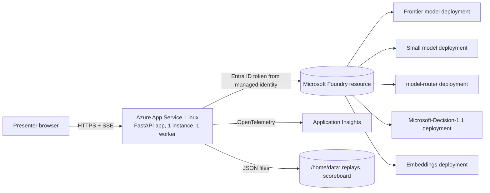

# Instruction.md — Token Economics Live

**Build spec for a live AI cost-optimisation demo on Azure App Service and Microsoft Foundry**

| | |
|---|---|
| Owner | Saurav Raghuvanshi, Digital Solution Engineer, Microsoft |
| Used in | Founder First Sessions, Bengaluru, 10 Dec 2026: "AI Unit Economics: Achieving quality without burning runway" (demo slide 32) |
| Written | 20 Nov 2026 |
| Audience of this file | GitHub Copilot coding agent (builder) and Saurav (operator) |

> **This file is the only source of truth.** Read all of it before writing code. If anything here conflicts with your assumptions, this file wins. Where a value must come from a human (Azure endpoint, region, prices, access code), never invent it: leave the placeholder, make the app show a clear warning, and list the gap in the pull-request description.

---

## 0. Kickoff prompt (paste this to the agent)

```text
Build the "Token Economics Live" demo exactly as specified in Instruction.md at the repo root.
Read the whole file first; it is the only source of truth.
Work through the milestones in section 20 in order, commit after each one, and keep all tests green.
Open a pull request whose description ticks every item in section 21 and lists any value I still need to provide.
Never hard-code a price: every price comes from config/pricing.json.
Never put keys or secrets in code, settings or the repo: use managed identity (Microsoft Entra ID).
Never call a real model from CI: tests run with FOUNDRY_MODE=fake.
```

### Rules for the agent

- **MUST** use Python 3.12, FastAPI, Server-Sent Events (SSE), the `openai` Python SDK against the Azure OpenAI **v1** endpoint with a Microsoft Entra ID token provider, and a static front end with no build step.
- **MUST** compute every cost with the formulas in section 8, from the `usage` block of each real response and the prices in `config/pricing.json`, with unit tests.
- **MUST** grade every answer with the deterministic rules in section 12 and show pass or miss on screen.
- **MUST** change exactly one lever per tab: the control lane and the candidate lane share everything else (same requests, same order, same prompt text, same model unless the lever is the model).
- **MUST** support a clearly badged Replay mode and a clearly badged Fake mode. Live, Replay and Fake must never be confusable on screen.
- **MUST NOT** invent prices, model names, endpoints or results; store keys; load scripts, fonts or styles from a CDN at runtime; or log secrets or tokens.
- **SHOULD** keep modules small and typed, add docstrings, and comment any non-obvious behaviour (especially caching and billing rules).

---

## 1. Goal and context

**Why this exists.** The talk argues that teams should stop counting tokens and start costing outcomes: cost per successful (accepted) outcome. The demo makes that tangible. For each runtime lever it sends the **same 5–10 requests** through two setups side by side, a **control** (today's usual setup) and a **candidate** (one lever changed), reads the tokens from every Microsoft Foundry response, prices them at list rates, grades every answer, and streams cost, savings and pass or miss to the screen in real time.

**Story link.** The talk opens with a CTO whose AI product is sold per seat to enterprises; a few power users drive most of the AI bill. The demo uses a fictional company with the same shape: **Contoso CloudDesk**, a helpdesk product with an AI assistant, sold per seat. The demo requests are one power user's day. The Scoreboard closes the loop with a "power-user month" projection.

**Inspiration (pattern only).** Drew Robbins showed a demo app called "Token Economics" in the Microsoft Tech Guru session *Runtime Tokenomics: Routing, Caching & Model Optimisation* (19 Nov 2026). Reproduce its interaction pattern with our own code and data; do not copy his code or data:

- One tab per lever: Prompt Caching, Model Router, Semantic Caching, Retry & Kill Switch.
- A mode switch per tab, a "Run N requests" button, and four KPI cards (for example "Total cost $control → $candidate", "Savings % lower", "Cached input share 0% → x%", "Accepted 3/3 pass").
- One row per request with Control and Candidate side by side: model used, tokens, cost, pass or miss; on the caching tab a stacked token bar (uncached input, cache write, cached read, output).
- A "How to Implement" button that opens a control-versus-candidate code diff, a dark-mode toggle, and a green "Azure Foundry Live" status pill.

**Golden rule (shown in the app footer):** *Keep a change only if cost per accepted outcome falls and quality holds.*

---

## 2. What the presenter must be able to do

1. Open the App Service URL on a laptop at the venue and see a green **"Foundry live"** pill (or a red pill with the reason).
2. Pick a lever tab, pick a mode, choose **N = 5–10 requests** (default 5; the Retry tab uses 3–6 documents), and press **Run**.
3. Watch each request appear as it completes: Control and Candidate side by side with the model that answered, tokens (uncached input, cached read, cache write, output, reasoning), latency, cost and pass or miss.
4. Watch the four KPI cards update live after every result.
5. Click any request to open an **Inspect** drawer: the exact messages sent (the cached prefix collapsed, with its token count), the answer, the raw `usage` block, and the cost calculation line by line.
6. Press **How to implement** to show the control-versus-candidate code for the current lever and mode.
7. Open **Scoreboard**: one row per lever run (cost, accepted, cost per accepted outcome, change versus control, latency) plus the **power-user month** projection.
8. If Foundry or the network fails: press **Replay last run**, which plays back the last successful live run, badged **"REPLAY · recorded <date, time IST>"**.
9. Optional: dark mode, larger text (A+), keyboard shortcuts (section 14).

---

## 3. Scope

**MVP (must ship):** the four lever tabs with all modes in section 11, Scoreboard with power-user month, live SSE streaming, Replay, Fake mode, status pill, How-to modals, Inspect drawer, access code, spend guard, Application Insights telemetry, `azd up` deployment to App Service, CI with tests.

**Stretch (only after section 21 is complete):** a History compaction tab; an Advisor pattern tab; an "All levers on" combined run; an Azure AI Gateway path with per-user limits as the backstop; an optional INR display with a presenter-entered exchange rate (null by default).

---

## 4. Architecture



| Decision | Choice | Why |
|---|---|---|
| Language and web framework | Python 3.12, FastAPI, served by gunicorn with one Uvicorn worker | Async calls in parallel lanes; SSE is simple; one worker keeps the in-memory run registry consistent |
| Model client | `openai` Python SDK (`AsyncOpenAI`) with `base_url = <resource>/openai/v1/` | The v1 API needs no `api-version` and supports Entra ID token refresh in the OpenAI client |
| Auth | `azure.identity` `DefaultAzureCredential` (managed identity in Azure, Azure CLI locally), scope `https://cognitiveservices.azure.com/.default` | No keys anywhere |
| Decision model client | `httpx.AsyncClient` POST to `<FOUNDRY_ENDPOINT>/providers/microsoft/v1/systemone` with a bearer token | It is not an OpenAI-format API |
| Real time | SSE (`text/event-stream`) with a heartbeat every 15 s | One-way server push is all we need; simpler than WebSockets |
| Front end | Static HTML, CSS and vanilla JavaScript (ES modules) served by FastAPI; no CDN, no web fonts | Venue Wi-Fi can be poor; nothing external to load |
| Token estimates for layout bars | `tiktoken` (`o200k_base`) | Display only; costs always use the API's `usage` |
| Storage | JSON files under `/home/data` (persistent on Linux App Service) | Replays and scoreboard survive restarts; no database needed |
| Infrastructure | Bicep + Azure Developer CLI (`azd`) | One command to provision and deploy |

---

## 5. Azure resources and model deployments

### 5.1 Resources

| Resource | Notes |
|---|---|
| Resource group | For example `rg-tokecon-demo` |
| App Service plan | Linux, `P0v3` (Premium v3), 1 instance |
| Web App | Python 3.12, system-assigned managed identity, HTTPS only, Always On, health check `/healthz`, FTPS disabled, minimum TLS 1.2, ARR affinity on |
| Log Analytics workspace + Application Insights | Workspace-based Application Insights |
| Microsoft Foundry resource and project | **Bring your own by default** (pass its resource ID and endpoints). Creating a new one is optional and must be behind a Bicep parameter |
| Role assignments | Web App managed identity → **Foundry User** on the Foundry resource (this role was previously named *Azure AI User*; the role ID did not change). If the decision endpoint returns 403, also assign **Cognitive Services User**. Give the developer's own account the same roles for local runs |

Look up role IDs by name instead of hard-coding GUIDs:

```bash
az role definition list --name "Foundry User" --query "[0].name" -o tsv      # or "Azure AI User" if the rename has not reached your tenant
az role definition list --name "Cognitive Services User" --query "[0].name" -o tsv
```

### 5.2 Model deployments

All deployments use **Global Standard** unless the region requires otherwise. Deployment names are environment variables; the defaults below are suggestions.

| Env var | Default deployment name | Model | Used by | Notes |
|---|---|---|---|---|
| `FRONTIER_DEPLOYMENT` | `gpt-6.1-sol` | GPT-6.1 Sol, or the newest GPT-5.6-family-or-later model available in your region | Control lane of tabs 1–3; frontier tier | Explicit cache breakpoints, `prompt_cache_options` and `cache_write_tokens` need the GPT-5.6 family or later on Standard deployments. Earlier models still cache automatically (set `PROMPT_CACHE_MODE=auto`) |
| `SMALL_DEPLOYMENT` | `gpt-4.1-mini` | A small, cheap chat model | Small tier for the decision router and the trap mode; Retry tab extractor | Must support JSON-schema structured outputs |
| `ROUTER_DEPLOYMENT` | `model-router` | `model-router`, version `2025-11-18` | Tab 2, Foundry model router mode | Configure routing mode and a model subset (5.3). Never name any deployment `auto` |
| `DECISION_DEPLOYMENT` | `decision-1.1` | `Microsoft-Decision-1.1`, version `1`, format `Microsoft` | Tab 2 decision router; Retry tab reviewer | Called through the decision API, not chat completions |
| `EMBEDDING_DEPLOYMENT` | `text-embedding-3-small` | An embeddings model | Tab 3, naive similarity mode | Only used by the trap mode |

Find exact model names and versions available to your resource, then create deployments:

```bash
az cognitiveservices account list-models -g <rg> -n <foundry-account> -o table

az cognitiveservices account deployment create -g <rg> -n <foundry-account> \
  --deployment-name gpt-6.1-sol --model-name <name-from-list> --model-version <version-from-list> \
  --model-format OpenAI --sku-name GlobalStandard --sku-capacity <capacity>

az cognitiveservices account deployment create -g <rg> -n <foundry-account> \
  --deployment-name model-router --model-name model-router --model-version 2025-11-18 \
  --model-format <format-shown-by-list-models> --sku-name GlobalStandard --sku-capacity 10

az cognitiveservices account deployment create -g <rg> -n <foundry-account> \
  --deployment-name decision-1.1 --model-name "Microsoft-Decision-1.1" --model-format Microsoft \
  --model-version "1" --sku-name GlobalStandard --sku-capacity 1
```

Region: choose one region where all five deployments are available (check the Foundry model availability pages and the model router supported regions). If a model is missing, deploy an available alternative, set its env var, and add its prices to `config/pricing.json`. Put the App Service in the same region as the Foundry resource.

### 5.3 Model router configuration (Foundry portal, Custom settings)

- Version `2025-11-18` (generally available; updated in place as models are added).
- **Routing mode:** start with **Balanced** (default). Try **Cost** in the dry run. Changes take up to five minutes to apply.
- **Model subset:** choose 3–5 models available in your region (for example one fast low-cost model, one mid model and one frontier model) so that every model the router can pick has a price in `config/pricing.json`. The app shows "price missing" for any routed model without a price.
- The routing fee is charged per 1M **input** tokens on every routed request, in addition to the selected model's usage.
- Every response's `model` field names the model that actually answered (for example `gpt-5.6-luna-2026-07-09`); use it for pricing and display.
- Claude models need their own deployment in the same resource before the router can use them; leave them out of the subset to keep setup simple.

---

## 6. Repository layout

```text
token-economics-live/
├─ Instruction.md                # this file
├─ README.md                     # setup, run, deploy, runbook pointer
├─ azure.yaml                    # azd project
├─ requirements.txt              # runtime deps (pinned)
├─ requirements-dev.txt          # pytest, pytest-asyncio, respx, ruff, mypy
├─ .env.example
├─ config/
│  └─ pricing.json               # the ONLY place prices live (Appendix D)
├─ infra/
│  ├─ main.bicep
│  ├─ main.parameters.json
│  └─ modules/ (appservice.bicep, monitoring.bicep, foundry-roles.bicep)
├─ app/
│  ├─ main.py                    # FastAPI app, routes, static files, startup checks
│  ├─ settings.py                # pydantic-settings, env vars from section 7
│  ├─ foundry.py                 # AsyncOpenAI v1 client, decision client, retry wrapper, fake client
│  ├─ usage.py                   # normalise usage blocks into a Usage dataclass
│  ├─ pricing.py                 # load + validate pricing.json, price lookup, cost functions
│  ├─ grading.py                 # deterministic graders (section 12)
│  ├─ prompts.py                 # system prompt, layouts, JSON schemas (section 10)
│  ├─ runs.py                    # run registry, orchestration, KPIs, replay save/load
│  ├─ sse.py                     # event formatting, heartbeat
│  ├─ guards.py                  # access code, single active run, spend guard
│  ├─ levers/
│  │  ├─ prompt_caching.py
│  │  ├─ model_routing.py
│  │  ├─ response_cache.py
│  │  └─ retry_killswitch.py
│  ├─ data/                      # Appendix A and B, verbatim
│  │  ├─ policies.md
│  │  ├─ requests_prompt_caching.json
│  │  ├─ requests_model_routing.json
│  │  ├─ requests_response_cache.json
│  │  ├─ cache_patterns.json
│  │  └─ invoices.json
│  └─ static/ (index.html, app.css, app.js, components/*.js, howto/*.json)
├─ replays/                      # known-good replays committed for offline fallback
├─ scripts/ (smoke_test.py, warmup.py, export_replays.py, measure_prefix.py)
└─ tests/ (test_pricing.py, test_usage.py, test_grading.py, test_cache_keys.py,
           test_retry_loop.py, test_sse_flow.py, test_replay.py)
```

---

## 7. Configuration

### 7.1 Environment variables

| Name | Required | Example or default | Purpose |
|---|---|---|---|
| `AZURE_OPENAI_BASE_URL` | Yes | `https://<resource>.openai.azure.com/openai/v1/` | v1 endpoint for chat completions and embeddings (the `https://<resource>.services.ai.azure.com/openai/v1/` form also works) |
| `FOUNDRY_ENDPOINT` | Yes | `https://<resource>.services.ai.azure.com` | Resource root for the decision API |
| `AZURE_TOKEN_SCOPE` | No | `https://cognitiveservices.azure.com/.default` | Token scope for both clients |
| `FRONTIER_DEPLOYMENT` | Yes | `gpt-6.1-sol` | Section 5.2 |
| `SMALL_DEPLOYMENT` | Yes | `gpt-4.1-mini` | Section 5.2 |
| `ROUTER_DEPLOYMENT` | Yes | `model-router` | Section 5.2 |
| `DECISION_DEPLOYMENT` | Yes | `decision-1.1` | Section 5.2 |
| `EMBEDDING_DEPLOYMENT` | Yes | `text-embedding-3-small` | Section 5.2 |
| `PROMPT_CACHE_MODE` | No | `explicit` | `explicit` = breakpoint + `prompt_cache_options` (GPT-5.6 family or later); `auto` = order + `prompt_cache_key` only, for earlier models, which return 400 for the explicit fields |
| `PROMPT_CACHE_KEY` | No | `clouddesk:policies:v1` | Reused for every request that shares the policy prefix |
| `DEFAULT_REQUEST_COUNT` / `MIN_REQUEST_COUNT` / `MAX_REQUEST_COUNT` | No | `5` / `5` / `10` | Count selector for tabs 1–3 |
| `DECISION_CONFIDENCE_MIN` | No | `0.70` | Below this, the decision router escalates to the frontier tier |
| `NAIVE_SIMILARITY_THRESHOLD` | No | `0.80` | Tab 3 trap mode; calibrate in the dry run (section 19) |
| `SAFETY_CEILING` / `DOC_TOKEN_BUDGET` | No | `6` / `8000` | Tab 4; the default candidate hard limit is three retries |
| `TIGHT_KILL_SWITCH_USD` | No | empty | Tab 4 "Tight kill switch" budget per document; set in the dry run; mode hidden while empty |
| `DEMO_ACCESS_CODE` | Yes in Azure | (secret you choose) | Required header `X-Demo-Code` on every endpoint that spends money |
| `MAX_SPEND_PER_HOUR_USD` | No | `2.00` | Spend guard across all runs (safety default; adjust) |
| `FOUNDRY_MODE` | No | `live` | `live` or `fake`. `fake` never calls Azure and is badged FAKE |
| `DATA_DIR` / `REPLAY_DIR` | No | `/home/data` / `/home/data/replays` | Persistent files |
| `PRICING_PATH` | No | `config/pricing.json` | Price file |
| `PRICING_OVERRIDE_JSON` | No | empty | Optional full JSON that replaces the price file without a redeploy |
| `APPLICATIONINSIGHTS_CONNECTION_STRING` | Set by infra | | Telemetry |
| `LOG_LEVEL` | No | `INFO` | |

### 7.2 Prices (`config/pricing.json`)

- Every price is **USD per 1M tokens, list price, Global Standard**, read from the Azure pricing pages (section 22). The file records `verified_on` and a `source` per entry.
- `null` means unknown. The app then shows **"price missing"** on that lane, marks totals **incomplete**, hides the savings figure, and shows a red banner. Never treat a missing price as zero.
- Until `verified_on` is set, every screen shows an amber banner: "Prices not verified: fill config/pricing.json".
- Routed models are matched from `response.model`, lower-cased, by the longest matching prefix in each entry's `match` list.
- Template with the prices that could be verified on 20 Nov 2026: Appendix D.

---

## 8. Cost model (exact)

### 8.1 Normalised usage for one chat completion

| Symbol | Source | Notes |
|---|---|---|
| `P` | `usage.prompt_tokens` | All input tokens |
| `C` | `usage.prompt_tokens_details.cached_tokens` | Cache reads; 0 if absent |
| `Wr` | `usage.prompt_tokens_details.cache_write_tokens` | Cache writes; reported on GPT-5.6-family-or-later Standard deployments; 0 if absent |
| `O` | `usage.completion_tokens` | Includes reasoning tokens |
| `R` | `usage.completion_tokens_details.reasoning_tokens` | Display only (already inside `O`) |
| `U` | `max(P − C − Wr, 0)` | Uncached, unwritten input |

### 8.2 Formulas

```text
chat_cost      = (U × input + C × cached_input + Wr × cache_write_30m + O × output) / 1,000,000
                 (+ Wr × input / 1,000,000 only if pricing.json sets "cache_write_additive": true)
router_fee     = P × router.routing_fee_per_1M_input / 1,000,000        (every call to ROUTER_DEPLOYMENT)
router_call    = router_fee + chat_cost priced at the routed model (response.model)
decision_cost  = decision_input_tokens × decision.input / 1,000,000      (output included at no charge)
embedding_cost = embedding_input_tokens × embeddings[model].input / 1,000,000
lane_cost      = sum of every call that lane made for that request
savings_%      = (control_total − candidate_total) / control_total × 100
cpa            = lane_total / accepted_count                           ("n/a" when accepted_count = 0)
cpa_change_%   = (cpa_candidate − cpa_control) / cpa_control × 100
cached_share_% = Σ C / Σ P × 100                                        (per lane)
```

- `cache_write_additive` defaults to `false` (the cache-write rate replaces the ordinary input rate for written tokens). Confirm the billing note on the Azure OpenAI pricing page during price verification and flip the switch if writes are billed on top of input.
- Use `decimal.Decimal` for money. Display per-request costs with 5 decimals (`$0.00110`), totals with 4 decimals, percentages with 1 decimal. Never round before summing.
- Grader calls cost nothing (the graders are deterministic). The Retry tab's reviewer call is part of the lane cost.

### 8.3 Worked examples (unit-test fixtures)

The prices below are **test fixtures only, not real prices**: large model input 2.00, cached input 0.20, cache write 2.50, output 8.00; small model input 0.40, cached input 0.10, output 1.60; routing fee 0.14; decision input 0.042 (USD per 1M tokens).

| Case | Usage | Expected cost (USD) |
|---|---|---|
| A. Cache write, large | P 3,600, C 0, Wr 3,074, O 150 → U 526 | 0.009937 |
| B. Cache read, large | P 3,600, C 3,074, Wr 0, O 150 → U 526 | 0.0028668 |
| C. No cache, large | P 3,600, O 150 | 0.0084 |
| D. Router to small | P 3,600, C 0, O 120, plus routing fee | 0.001632 + 0.000504 = 0.002136 |
| E. Decision call | 45 input tokens | 0.00000189 |
| Run, 5 requests | Control 5 × C = 0.0420; candidate A + 4 × B = 0.0214042 | Savings 49.0% |
| Cost per accepted | Control 5 accepted, candidate 4 accepted | CPA 0.0084 vs 0.00535105, change −36.3% |

`tests/test_pricing.py` must assert every row exactly.

---

## 9. Data set

- **Company:** Contoso CloudDesk, fictional. All names, prices and rules are demo data.
- **Policy corpus (stable prefix):** `app/data/policies.md`, verbatim from Appendix A: a plan table, 11 policies (`BILL-1`, `BILL-2`, `BILL-3`, `SEAT-1`, `SEAT-2`, `DATA-1`, `DATA-2`, `SEC-1`, `SEC-2`, `SLA-1`, `AI-1`) and six answer-style examples (one in Hindi). It is 1,232 words and 7,005 characters, roughly 1,750 tokens by a four-characters-per-token rule of thumb. `scripts/measure_prefix.py` must measure the exact count with `tiktoken` `o200k_base`, and a test must assert the rendered system prompt is **at least 1,024 tokens** (the minimum for prompt caching).
- **Byte-identical rule:** load the file once at startup, never reformat it, and never put timestamps, request IDs or user data before or inside it.
- **Request sets (Appendix B):** 10 requests for each of tabs 1–3 and 6 invoices for tab 4, in a **fixed order**. A run uses the first N. Two requests in tab 1, one in tab 2 and one in tab 3 are in Hindi (Devanagari) to show the same levers work across languages.
- Every request carries its expected outcome (policies to cite, facts that must appear, things that must not appear, acceptable decisions, expected tier) for the graders in section 12.

---

## 10. Prompts and response format

### 10.1 System prompt (`ROLE_INSTRUCTIONS`, exact text)

```text
You are CloudDesk Assist, the support assistant for Contoso CloudDesk, a helpdesk product sold per seat to businesses.
Rules:
1. Answer only from the policies below. If they do not cover the request, say so and offer to connect a human agent.
2. Cite every policy you rely on in the policy_ids field and in the answer text, in square brackets, for example [BILL-1].
3. If the customer asks for something a policy does not allow (for example skipping verification, refunding to a different account, or a feature their plan does not include), refuse that part politely and say what they can do instead.
4. Reply in the customer's language. Always write numbers with the digits 0-9.
5. Keep answers under 120 words; technical answers that include code may use up to 250 words.
6. Set decision to: inform (information only), approve (every requested action is allowed), partial (some parts allowed, some not), refuse (the main request is not allowed), or escalate (a human must handle it).
```

The **stable prefix** is `ROLE_INSTRUCTIONS + "\n\n## Policies\n\n" + policies.md`.

### 10.2 Response format (all chat calls in tabs 1–3)

Use structured outputs so grading is deterministic:

```json
{
  "type": "json_schema",
  "json_schema": {
    "name": "support_answer",
    "strict": true,
    "schema": {
      "type": "object",
      "additionalProperties": false,
      "required": ["answer", "policy_ids", "decision"],
      "properties": {
        "answer": {"type": "string"},
        "policy_ids": {
          "type": "array",
          "items": {"type": "string", "enum": ["BILL-1","BILL-2","BILL-3","SEAT-1","SEAT-2","DATA-1","DATA-2","SEC-1","SEC-2","SLA-1","AI-1"]}
        },
        "decision": {"type": "string", "enum": ["inform","approve","partial","refuse","escalate"]}
      }
    }
  }
}
```

Do **not** set `temperature` or `top_p` (some reasoning models reject them). Use `max_completion_tokens` (600), not `max_tokens`. If a response cannot be parsed as JSON, grade it as a miss with reason `unparseable`.

### 10.3 Prompt layouts

| Layout | Used by | Messages |
|---|---|---|
| **Customer first** (breaks the prefix) | Tab 1 control | `system`: `ROLE_INSTRUCTIONS` only. `user`: `"Received <ISO time> · ticket <id>\nCustomer: <message>\n\n## Policies\n\n<policies.md>"` |
| **Policies first** (stable prefix) | Tab 1 candidate and both lanes of tab 2 | `system`: stable prefix. `user`: `"Customer: <message>\n\n(received <ISO time> · ticket <id>)"`. Use `prompt_cache_key = PROMPT_CACHE_KEY`. Tab 1 candidate adds an explicit breakpoint and 30-minute TTL when `PROMPT_CACHE_MODE=explicit`; tab 2 omits explicit fields for older eligible models. |
| **Policies first, no input cache** | Tab 3: baseline and candidate generation on supported GPT Standard | Same messages in both lanes, `prompt_cache_options = {mode: explicit}` without a key or breakpoint. Older models use the customer-first layout with no cache fields; report any implicit reads or writes. |
| **Short question only** | Tab 2 classifier for both routed modes | Decision API `state` = the customer message only (no policies) |

Pass the caching fields with `extra_body={...}` so the code works whatever the SDK version. Code for each layout: Appendix C.

---

## 11. Lever specifications

Common to every tab: a title, a one-line subtitle, a mode switch, a count selector, **Run** (disabled while a run is active), **Replay last run**, four KPI cards, a request list, the Inspect drawer, and the How-to modal for the current mode. Control and candidate lanes run **concurrently with each other**; requests **within a lane run in order**, one at a time (prompt caching depends on order).

### 11.1 Tab 1 — Prompt caching

- **Subtitle:** "Same content, same tokens. Only the order changes."
- **Control:** frontier model, *customer first* layout, no caching fields.
- **Candidate:** frontier model, *policies first* layout, cache key, explicit breakpoint and 30-minute TTL when `PROMPT_CACHE_MODE=explicit`.
- **Prompt layout bar** (above the list, for each lane): segments `System`, `Policies (~N tok) · CACHED PREFIX`, `Customer (~M tok)` sized by `tiktoken` estimates and labelled "estimated"; control shows the customer segment first.
- **KPIs:** Total cost (control → candidate) · Savings (% lower) · Cached input share (control → candidate) · Accepted (control x/N, candidate y/N).
- **Row:** a stacked bar per lane with uncached input (blue), cache write (purple), cached read (green) and output (orange), scaled to the largest lane total in the run; text such as `3,074 written · $0.00994` or `3,074 cached · $0.00287`; pass or miss.
- **Explain in a tooltip:** request 1 usually writes the cache; from request 2 the policies are read from it. On GPT-5.6-family-or-later models, a badly ordered prompt can pay to write the cache on every call and never read it (implicit mode places a breakpoint on the latest message).
- **Caveat to show in Inspect:** if more than about 15 requests per minute share one prefix and key, some can miss the cache.

### 11.2 Tab 2 — Model routing

- **Subtitle:** "Send routine work to a cheaper model; keep hard cases on the frontier."
- **Both lanes** use the *policies first* layout, so prompt caching affects them equally; only the model choice differs.
- **Control (all modes):** frontier model for every request.
- **Mode A, Foundry Model Router:** classify the question before adding policies. A confident routine result restricts the configured router to GPT-4.1-mini; harder or uncertain questions keep the baseline's GPT-6.1 Sol in the quality pool. Pass the preview `routing_config` to the published router agent. Verify the returned mode and actual `response.model`, and include both the classifier and routing fees.
- **Mode B, Decision router (pre-RAG):** candidate first sends only the customer message to Microsoft-Decision-1.1 with one `choice` question (Appendix C.3). If the choice is `small` with probability ≥ `DECISION_CONFIDENCE_MIN`, the small model answers; otherwise the frontier model answers. Both answer with the full policies prefix attached. Show `tier · 98% conf · 45 tok classified · $…`.
- **Mode C, Small model for all (the trap):** candidate always uses the small model. Its purpose is to show that the cheapest model can miss and raise cost per accepted outcome.
- **KPIs:** Control cost per accepted · Candidate cost per accepted · Change in cost per accepted (%) · Route mix and accepted (for example `3 small / 2 frontier · 4/5 pass`).
- **Row:** a badge with the request category (Routine, Multi-policy, Trap, Deep reasoning), model chips, `in / out` tokens, router fee or decision confidence, cost, pass or miss, and a small "expected tier: frontier" hint.

### 11.3 Tab 3 — Response caching

- **Subtitle:** "A hit skips the whole model call, but only when the key is exact."
- **Control:** the frontier model answers every request; there is no saved-answer lookup. Both lanes use the same prompt and disable input caching when the provider supports it. Show both lanes' input-cache read and write counts; if either is nonzero, the run does not publish an isolated savings verdict.
- **Mode A, Fact-guarded cache (candidate):** normalise the text, strip conversational framing, detect language (Devanagari → `hi`, else `en`), match the curated patterns in `cache_patterns.json`. **Exactly one** pattern with all its parameters resolved → build the key; zero or several matches → **bypass** (call the model, do not store). The key hashes `{version, language, topic, params, product: "clouddesk", system_prompt_sha256, model: deployment}`; the display key looks like `v1:en:refund_timing:destination=card`. Miss → call the model and store the answer; hit → return the stored answer with no model call.
- **Mode B, Naive similarity (the trap):** embed the normalised question; if cosine similarity with any stored entry is ≥ `NAIVE_SIMILARITY_THRESHOLD`, return that entry's answer regardless of facts. Embedding calls are part of the candidate's cost.
- The cache is **cleared at the start of every run** so results repeat; a **Clear cache** button and a **live follow-up box** ("Ask a question against the cache") use the current cache; follow-ups are shown as "not graded".
- **Badges:** `Model used → stored #01` (orange), `From cache #01 · model skipped` (green), `Wrong answer from cache #01 (sim 0.88)` (red, when a hit fails grading), `Bypassed: no single exact pattern` (grey).
- **Right panel:** cached entries with display key, question, answer and hit count.
- **KPIs:** Model calls (control → candidate) · Cost savings (%) · Accuracy (candidate x/N; control x/N underneath) · Average latency (control → candidate).

### 11.4 Tab 4 — Retry limits and kill switch

- **Subtitle:** "Keep retries that fix real errors; stop loops that never change."
- **Workload:** an invoice intake agent processes the documents in `invoices.json` (Appendix B.5). **Roles per attempt:** Extractor (small model, structured JSON), Tool (a **simulated** currency converter, faulty by design for USD and EUR, labelled "simulated" on screen), Validator (deterministic code), Reviewer (Microsoft-Decision-1.1 `noul` question, only after validation passes; if `DECISION_DEPLOYMENT` is empty, the small model answers yes or no). A document is **accepted** when validation passes and the reviewer's probability is ≥ 0.7.
- **Validator errors** (codes): `MISSING_FIELD:<name>`, `GSTIN_FORMAT`, `LINE_MISMATCH:<index>` (|qty × unit_price − amount| > 1), `SUBTOTAL_MISMATCH` (|Σ line amounts − subtotal| > 1), `TOTAL_MISMATCH` (|subtotal + Σ taxes − total| > 1), `FX_RATE_UNAVAILABLE:<currency>`.
- **Evidence key:** SHA-256 of the canonical JSON of the extraction's structured fields (vendor, GSTIN, invoice number, date, currency, line items, subtotal, taxes, total; **not** free-text notes) plus the sorted error codes.
- **Control (all modes):** retry failures until `SAFETY_CEILING` attempts or an authorized presenter stops future baseline retries. Let the active attempt finish; later invoices get one initial try. Keep the candidate running and exclude the stopped batch from the Scoreboard and Replay.
- **Mode A, Three-retry guardrail:** one initial attempt followed by at most three retries. Record repeated evidence even when the fault persists. At the retry or document token limit, **hand off** with the output and errors.
- **Mode B, No retries (limit = 0):** hand off on the first failure (shows that over-tight limits lose recoverable documents).
- **Mode C, Tight kill switch:** also stop on repeated evidence or the per-document spend cap `TIGHT_KILL_SWITCH_USD`; hidden while that variable is empty.
- **Count selector:** 3–6 documents (default 3: invoices 1–3).
- **Live:** stream attempt and check results before the lane receipt. The receipt includes the full attempt chain, stop reason, model-call count and cost.
- **KPIs:** Role LLM calls (control → candidate) · Cost per accepted (% change) · Wasted token share (control → candidate) · Accepted documents (control → candidate, of N). **Wasted tokens** = tokens spent on attempts whose evidence key equals the previous attempt's key in the same document.

### 11.5 Scoreboard

- A table with the latest completed run of each lever and mode: lever · mode · N · control cost · candidate cost · savings % · accepted (control, candidate) · cost per accepted (control, candidate) · change % · average latency · time (IST) · Live or Replay badge.
- **Power-user month** card: pick a run; inputs "requests per power user per month" (default 1,000, labelled "your assumption") and "seat price, USD per month" (default 25, labelled "from the opening story, illustrative"). Output: projected monthly AI cost for control and candidate = cost per accepted × requests, and each as a percentage of the seat price. Label the card **"Projection from one live run, not a forecast."**

---

## 12. Grading (accepted outcomes)

Deterministic, no model calls. For tabs 1–3 a lane result **passes** when all of these hold:

1. The response parses against the schema in 10.2.
2. Every ID in `expect.policies` is present in `policy_ids` (extra IDs are allowed).
3. Every regex in `expect.must` matches `answer` (case-insensitive, Unicode).
4. No regex in `expect.must_not` matches `answer`.
5. If `expect.decision` is present, `decision` is one of its values.

For cache hits, grade the **stored** answer against the **current** request's expectations (this is how a wrong hit is caught). Show the failed rule as the miss reason in the row and in Inspect. Tab 4 grading is in 11.4.

---

## 13. Backend API and server-sent events

### 13.1 Endpoints

| Method and path | Auth | Purpose |
|---|---|---|
| `GET /healthz` | none | Returns `ok` (App Service health check); no Azure calls |
| `GET /api/status` | none | `{mode: live|fake|replay-only, foundry: ok|error, detail, deployments: {name: ok|error}, prices_verified, verified_on, missing_prices: [...]}`. Checks each deployment with the cheapest possible call, cached for 60 s |
| `GET /api/config` | none | Tabs, modes, request lists (id, text, language, category), count limits, deployment names, sanitised price table |
| `POST /api/runs` | `X-Demo-Code` | Body `{lever, mode, count}` → `{run_id}`. Rejects with 409 if a run is active and 429 if the spend guard is reached |
| `GET /api/runs/{run_id}/events` | none (run ids are random UUIDs) | SSE stream for one run |
| `GET /api/runs/{run_id}` | none | Full run JSON after completion |
| `POST /api/replays/{lever}/{mode}` | none | Starts a replay run of the saved recording; streams through the same events endpoint with `replay: true` |
| `POST /api/cache/clear` | `X-Demo-Code` | Clears the tab 3 cache |
| `POST /api/cache/ask` | `X-Demo-Code` | Body `{question, mode}`; returns hit or miss, key, answer, cost (not graded) |
| `GET /api/scoreboard` | none | Latest run per lever and mode |

### 13.2 Event stream

Send `Content-Type: text/event-stream`, `Cache-Control: no-cache`, `X-Accel-Buffering: no`; exclude this route from any compression middleware; send a comment line `: ping` every 15 seconds. Event types, in order:

| Event | Payload (JSON) |
|---|---|
| `run_started` | `run_id, lever, mode, count, started_at, live|replay|fake, prices_verified` |
| `request_started` | `run_id, idx, request_id, text, lane` |
| `lane_result` | `run_id, idx, request_id, lane, status (ok|error|price_missing), calls[], totals{cost_usd, latency_ms, tokens}, pass, miss_reasons[], lever_detail{}, answer_preview` |
| `kpis` | `run_id, control{...}, candidate{...}, savings_pct, cpa_change_pct, signal{...}, complete` |
| `run_completed` | `run_id, summary{...}, saved_replay` |
| `run_error` | `run_id, message, fatal` |

Each item in `calls[]`: `kind (chat|router|decision|embedding|tool|validator), deployment, response_model, usage{prompt, cached, cache_write, completion, reasoning}, cost_usd (string), latency_ms, x_request_id`. Costs are strings to keep `Decimal` precision. Example payloads: Appendix G.

### 13.3 Orchestration

- For request `i`: emit `request_started` for both lanes, run both lanes with `asyncio.gather`, emit each `lane_result` as soon as it finishes, then emit `kpis`. Lanes keep their own order across requests.
- **Transport retries:** a wrapper retries 429 and 5xx up to 2 times with backoff that honours `Retry-After`. Count these as `transport_retries` in the call record; they are not the lever's retries. Set the SDK's own `max_retries=0` so counts are exact. Timeout 60 s per call.
- A non-retryable error marks that lane result `status: error`, excludes it from totals (KPIs show "incomplete"), and the run continues.
- On completion, save the run (all events with relative timestamps) to `REPLAY_DIR/<lever>-<mode>.json` and update the scoreboard file.
- **Replay** re-emits the saved events with their original spacing (a 2× speed toggle is allowed) and badges every screen "REPLAY · recorded <time IST>". It makes no Azure calls.

---

## 14. Front end

**Layout** (projector-friendly at 1366×768 and 1920×1080): a header with "Token Economics · Live" on the left, tabs in the centre (Prompt caching · Model routing · Response caching · Retry & kill switch · Scoreboard), and on the right **{ } How to implement**, **Dark**, **A+**, and the status pill (green "Foundry live", amber "Replay", grey "Fake data", red "Offline: <reason>"). Banners for unverified or missing prices sit under the header. Footer: "Keep a change only if cost per accepted outcome falls and quality holds."

**Look:** light grey page, white cards with subtle borders; dark mode inverts. Savings in green, misses and wrong cache hits in red, the active tab and primary button in purple. Token colours: uncached input blue, cache write purple, cached read green, output orange, each also named in a legend (never colour alone). System font stack (Segoe UI on Windows); body at least 16 px, KPI values at least 28 px. All assets local.

**Components:** KPI card (label, value, small sub-value, animated change), lane row (model chip, token bar or tokens text, cost, latency, pass or miss with reason tooltip), request card (number, text clamped to two lines, category badge, two lane rows), prompt layout bar (tab 1), cache panel (tab 3), attempt chain (tab 4), Inspect drawer, How-to modal with a two-column diff (Appendix C), toast for errors.

**Numbers:** costs `$0.00110` per request and `$0.0298` totals; tokens with thousands separators; latency `1.7 s` or `579 ms`; savings `55.3% lower`; never show more precision than the data has.

**Keyboard:** `1`–`5` switch tabs, `R` run, `P` replay, `H` how-to, `D` dark, `+` larger text, `Esc` close.

**Access code:** the first time a protected action is used, prompt for the code and keep it in `sessionStorage`.

---

## 15. Reliability, safety and cost guards

- Exactly **one active run** at a time; a second Run returns 409 and the UI says so.
- **Spend guard:** sum the priced cost of all live calls in the last 60 minutes; refuse new runs above `MAX_SPEND_PER_HOUR_USD`.
- **Access code** on every spending endpoint; compare in constant time; never log it.
- Synthetic data only; no personal data. Do not send policies or answers to Application Insights in full: log IDs, tokens, costs, latency and pass or miss.
- **Startup checks:** load and validate `pricing.json` and all data files (schema, ID references, unique IDs); log a clear error and show it in `/api/status` if anything is wrong.
- **Fake mode** (`FOUNDRY_MODE=fake`): a deterministic fake client returns recorded usage and answers from `tests/fixtures`; every screen shows a grey "FAKE DATA" badge.
- **Offline fallback:** `replays/` holds known-good recordings committed after the dry run; `REPLAY_ONLY=true` serves them locally with `uvicorn app.main:app` if the venue has no internet at all.

---

## 16. Observability

- Use `azure-monitor-opentelemetry`. One span per model call with attributes `lever, mode, lane, request_id, deployment, response_model, prompt_tokens, cached_tokens, cache_write_tokens, completion_tokens, reasoning_tokens, cost_usd, latency_ms, pass, transport_retries`, and a custom event `run_completed` with the KPIs.
- Put this query in the README:

```kusto
dependencies
| where timestamp > ago(1d) and isnotempty(customDimensions.lever)
| extend lever = tostring(customDimensions.lever), lane = tostring(customDimensions.lane),
         model = tostring(customDimensions.response_model), cost = todouble(customDimensions.cost_usd)
| summarize calls = count(), cost_usd = sum(cost) by lever, lane, model
| order by lever asc, lane asc
```

---

## 17. Testing

- **Unit:** pricing formulas (every row of 8.3), usage normalisation (with and without `cache_write_tokens` and `reasoning_tokens`), price lookup by prefix, graders (each rule and each request's expectations against hand-written good and bad answers), cache keys (paraphrases share a key; plan, destination and language change it; multi-intent bypasses), evidence-key loop (control reaches the ceiling, candidate hands off, recoverable documents pass on attempt 2 in the fake client), KPI arithmetic.
- **API and SSE:** with the fake client, a run of 10 emits events in the documented order, totals equal the sum of rows, and replay produces the same final KPIs.
- **Data:** `policies.md` renders to at least 1,024 tokens; every request references existing policy IDs; every `must` regex compiles.
- **Smoke test (live, manual):** `python scripts/smoke_test.py --base-url https://<app> --code <access-code>` runs one request per lever and mode, then fails if any usage block is missing, any price is missing, or any stream does not complete.
- **Timing:** a live run of 10 requests in tabs 1–3 should finish in under 90 seconds; record actual times in the README after the dry run.
- CI runs `ruff`, `mypy` (non-strict) and `pytest` with `FOUNDRY_MODE=fake`.

---

## 18. Deployment

1. **Prerequisites:** Azure subscription, Azure CLI, Azure Developer CLI, Python 3.12, a Foundry resource with the five deployments (section 5), and Owner or User Access Administrator rights to create role assignments.
2. **Configure:** `azd env new tokecon-demo`, then `azd env set` for `AZURE_LOCATION`, `FOUNDRY_RESOURCE_ID`, `AZURE_OPENAI_BASE_URL`, `FOUNDRY_ENDPOINT`, the five deployment names, `FOUNDRY_USER_ROLE_ID` and optionally `COGNITIVE_SERVICES_USER_ROLE_ID` (from the commands in 5.1), and `DEMO_ACCESS_CODE`.
3. **Provision and deploy:** `azd up`. Bicep creates the plan, web app, monitoring and the cross-resource-group role assignments on the existing Foundry resource; azd zips and deploys the app with an Oryx build (`SCM_DO_BUILD_DURING_DEPLOYMENT=true`).
4. **App settings** (set by Bicep): every variable in 7.1 except secrets, plus `SCM_DO_BUILD_DURING_DEPLOYMENT=true` and `WEBSITES_ENABLE_APP_SERVICE_STORAGE=true`. `DEMO_ACCESS_CODE` is set as an app setting from the azd environment and never committed.
5. **Startup command:** `gunicorn --workers 1 --worker-class uvicorn.workers.UvicornWorker --timeout 600 --bind 0.0.0.0:8000 app.main:app`. Keep one instance and one worker: the run registry is in memory.
6. **Streaming on App Service:** keep the 15-second heartbeat; App Service front ends close idle connections after about four minutes, and every run must finish well inside that.
7. **CI/CD:** [Set up the GitHub Actions deployment identity](README.md#github-actions-releases). The workflow in Appendix F.3 tests pushes and pull requests and publishes the current `main` revision once enabled.
8. **After deploy:** fill and date `config/pricing.json` (or set `PRICING_OVERRIDE_JSON`), run the smoke test, run each tab twice, then `python scripts/export_replays.py` and commit the recordings to `replays/`.

Skeletons for `azure.yaml`, Bicep and the workflow: Appendix F.

---

## 19. Presenter runbook

**Day before (dry run):** deploy; verify every price against the pricing pages and set `verified_on`; run every tab and mode twice; set `TIGHT_KILL_SWITCH_USD` so the tight mode stops the runaway invoice early; calibrate `NAIVE_SIMILARITY_THRESHOLD` so that requests rc-03 and rc-06 produce wrong hits in naive mode but fact-guarded mode stays correct; export and commit replays; screenshot the Scoreboard for the deck backup slide.

**30 minutes before:** open the app on the presenting laptop; status green; banners gone; run tab 1 once (this also warms the cache for 30 minutes, so request 1 may then show a read instead of a write: say so if it happens); clear the tab 3 cache; set every count to 5; open the Replay buttons once to confirm the recordings load.

**Live, about six minutes, five requests per run (matches the notes on slide 32):**

| Time | Tab and action | What to point at | Line |
|---|---|---|---|
| 0:00–0:30 | Header | Status pill, tabs | "Same requests, two setups, priced token by token. One lever per tab." |
| 0:30–1:45 | Prompt caching → Run | Layout bar; request 1 writes, 2+ read; the four cards | "Same content, same tokens. Only the order changed." |
| 1:45–3:15 | Model routing → ask the room → Run Foundry model router → switch to Decision router → Run | Routed model, routing fee, a trap escalated to frontier, any miss | "Route routine work to a small model. Keep hard cases on the frontier." |
| 3:15–4:30 | Response caching → Run fact-guarded → switch to Naive similarity → Run | Model calls skipped; the red wrong-answer badge | "A hit saves the whole call, but only with exact keys." |
| 4:30–5:15 | Retry & kill switch → Run 3 | Runaway invoice: ceiling in control, hand-off in candidate | "Retry only on new evidence. The exit is a hand-off." |
| 5:15–6:00 | Scoreboard → power-user month | Cost per accepted per lever; projection vs the $25 seat | "Same seat, smaller bill per power user. This is a projection from one run." |

**Rules on stage:** say only numbers that are on the screen; savings vary run to run; prices are list prices from the reviewed file. **If anything fails:** press Replay (badged), then use the deck's backup slides.

---

## 20. Build order (milestones)

1. **M1 Skeleton:** settings, data loading and validation, pricing and usage modules with all tests, fake client, `/healthz`, `/api/status`, static shell with tabs.
2. **M2 Prompt caching end to end** (live and fake), SSE, KPI cards, Inspect drawer, How-to modal.
3. **M3 Model routing** (three modes, decision client).
4. **M4 Response caching** (patterns, keys, naive mode with embeddings, cache panel, follow-up box).
5. **M5 Retry and kill switch** (agent loop, simulated tool, validator, reviewer, attempt chains).
6. **M6 Scoreboard, power-user month, replay, export script.**
7. **M7 Infrastructure and CI/CD:** Bicep, azd, workflow, smoke test, README.
8. **M8 Polish:** dark mode, A+, keyboard shortcuts, accessibility pass, empty and error states.

---

## 21. Definition of done

- [ ] `azd up` provisions and deploys from a clean clone; `/healthz` returns `ok`; the status pill is green with all five deployments `ok`.
- [ ] No keys, connection secrets or tokens anywhere in the repo or app settings; the web app reaches Foundry with its managed identity.
- [ ] Every tab runs N = 5–10 (tab 4: 3–6) live and streams each lane result as soon as it completes; totals equal the sum of the rows.
- [ ] Every cost follows section 8 exactly; every row of 8.3 is a passing test; missing prices are flagged and never counted as zero.
- [ ] Every answer is graded per section 12 and every miss shows its reason.
- [ ] All modes in section 11 exist and behave as described; How-to modals show the Appendix C code for every lever and mode.
- [ ] Replay and Fake modes work without Azure and are clearly badged; replays committed to `replays/` load in `REPLAY_ONLY` mode.
- [ ] Spend guard, single active run and access code are enforced and tested.
- [ ] Telemetry reaches Application Insights and the README query returns rows.
- [ ] README covers setup, configuration, price verification, deployment, smoke test, dry run and the runbook.
- [ ] The pull-request description lists every value Saurav must still provide.

---

## 22. Facts and sources (checked 20 Nov 2026)

| Fact used in this spec | Source |
|---|---|
| Prompt caching needs at least 1,024 identical leading tokens; reads show in `prompt_tokens_details.cached_tokens`; GPT-5.6-family-or-later Standard deployments also report `cache_write_tokens`, support `prompt_cache_key`, explicit `prompt_cache_breakpoint` and `prompt_cache_options` (`mode` implicit or explicit, `ttl` 30m default); earlier models return 400 for the explicit fields; cache writes can be charged on GPT-5.6 and later; ~15 requests per minute per prefix and key | https://learn.microsoft.com/en-us/azure/foundry/openai/how-to/prompt-caching (updated 6 Nov 2026) |
| Model router: one deployment picks a model per request; Balanced (default), Cost and Quality modes; model subsets; version 2025-11-18 GA; every response's `model` field names the model that answered; routing fee per 1M input tokens plus the selected model's usage; Monitor tab compares cost with single-model baselines | https://learn.microsoft.com/en-us/azure/foundry/openai/concepts/model-router (updated 18 Nov 2026); https://learn.microsoft.com/en-us/azure/foundry/openai/how-to/model-router-configure; https://learn.microsoft.com/en-us/azure/foundry/openai/concepts/model-router-how-it-works |
| Microsoft-Decision-1.1: GA; `choice`, `noul` and `score` questions; endpoint `<resource>/providers/microsoft/v1/systemone`; Global Standard input $0.042 per 1M tokens, output included at no charge | https://learn.microsoft.com/en-us/azure/foundry/foundry-models/how-to/use-foundry-models-microsoft-decision; https://techcommunity.microsoft.com/blog/azure-ai-foundry-blog/introducing-microsoft-decision-1-1-build-faster-more-efficient-ai-applications-w/4573877 (18 Nov 2026) |
| v1 API with the OpenAI client and an Entra ID token provider (`api_key=token_provider`, `base_url=.../openai/v1/`) | https://learn.microsoft.com/en-us/azure/foundry/openai/api-version-lifecycle; https://learn.microsoft.com/en-us/azure/developer/ai/how-to/switching-endpoints |
| Foundry User role (formerly Azure AI User; role ID unchanged) | https://learn.microsoft.com/en-us/azure/foundry/concepts/rbac-foundry |
| DeepSeek V4.1 Flash Global: input $0.30, cached input $0.006, output $1.20 per 1M tokens | https://azure.microsoft.com/en-us/pricing/details/ai-foundry-models/deepseek/ (retrieved 20 Nov 2026) |
| Azure OpenAI model prices (to fill in) | https://azure.microsoft.com/en-us/pricing/details/azure-openai/ (prices did not render in an automated fetch on 20 Nov 2026; read them in a browser) |
| Model router routing fee (to confirm) | https://azure.microsoft.com/en-us/pricing/details/ai-foundry-models/model-router/ (did not render a value on 20 Nov 2026). Drew Robbins' demo showed "$0.14/1M"; an independent tracker lists $0.14 Global and $0.154 Data Zone |
| Demo pattern and lever results (−53%, −35%, −59%, −26%, −66% in Drew's experiments) | Microsoft Tech Guru, Runtime Tokenomics: Routing, Caching & Model Optimisation, 19 Nov 2026 (recording and recap). Do not show his numbers as ours |

---

## Appendix A — Policy corpus (`app/data/policies.md`, verbatim)

Copy everything between the two marker lines into `app/data/policies.md` exactly (UTF-8, LF line endings, no trailing spaces). Do not reformat it.

<!-- BEGIN policies.md -->
````markdown
# Contoso CloudDesk customer policies (version 2026-11-v1)

All names, prices and rules in this document are fictional demo data.

## Plans at a glance

| Plan | Price | Seats | AI actions included | Audit-log export | Single sign-on | Support |
|---|---|---|---|---|---|---|
| Starter | ₹499 per seat per month, billed monthly | 1 to 24 | 200 per seat per month | Not available | Not available | Email, next business day |
| Business | ₹899 per seat per month, monthly or annual | Minimum 5 | 500 per seat per month, pooled | Last 90 days | Not available (MFA enforcement only) | Chat and email, 8 business hours |
| Enterprise | Custom price, annual only | Minimum 50 | 2,000 per seat per month, pooled | Last 12 months | SAML 2.0 and OIDC | 24x7, P1 response within 1 hour |

## BILL-1 Invoices, GST and corrections
- Invoices are issued on the 1st of each month. Accounts billed in India are invoiced in INR with GST; all other accounts are invoiced in USD.
- The legal name, billing address or GSTIN on an invoice can be corrected for invoices issued in the last 30 days. Corrected invoices are reissued within 2 business days.
- Invoices older than 30 days cannot be edited. Billing issues a credit note and a new invoice instead.
- Only the account's billing contact or an admin can request a correction, and only from their registered email address.

## BILL-2 Refunds
- Annual plans: a pro-rated refund is available if it is requested within 30 days of the renewal date. After 30 days there is no refund, but seats can be reduced at the next renewal (see SEAT-2).
- Monthly plans: no refunds. A cancellation takes effect at the end of the current billing month.
- Approved refunds go only to the original payment method and appear within 5 to 10 business days, depending on the bank. Refunds issued as account credit appear immediately.
- Support cannot send a refund to a different card, bank account or person.

## BILL-3 Failed payments and suspension
- If a payment fails, CloudDesk retries it 3 times over 7 days and emails the billing contact after each attempt.
- At 14 days past due the account becomes read-only: users can view tickets but cannot create tickets or reply.
- At 45 days past due the account is suspended. Data is kept for 90 days after suspension and then deleted (see DATA-2).
- Paying the outstanding invoice restores full access within 1 hour.

## SEAT-1 Adding seats
- Admins can add seats at any time from Admin > Billing > Seats. New seats are active immediately.
- Added seats are charged pro-rata on the next invoice for the rest of the current term.
- Business requires at least 5 seats and Enterprise requires at least 50 seats.

## SEAT-2 Removing seats and downgrades
- On annual plans, seat reductions and plan downgrades take effect at the next renewal. Mid-term reductions are not possible.
- On monthly plans, reductions take effect at the start of the next billing month.
- Removing a seat does not delete that user's tickets; they are reassigned to an admin.

## DATA-1 Data export
- Admins can export tickets and contacts at any time as CSV or JSON from Settings > Data > Export.
- Audit-log export covers the last 90 days on Business and the last 12 months on Enterprise. Starter has no audit-log export.
- Large exports are emailed as a download link within 24 hours. Download links expire after 7 days.

## DATA-2 Deletion and retention
- Deleted tickets stay in Trash for 30 days and an admin can restore them. After 30 days they are permanently deleted and cannot be recovered.
- When an account is closed, its data is deleted 90 days after closure.
- Enterprise customers can request a deletion certificate after permanent deletion.

## SEC-1 Account access and verification
- Changing the account owner or an admin email requires both a request from another existing admin and a signed request on company letterhead sent to security@clouddesk.example.
- Support agents and the assistant can never skip identity verification or change an admin email in chat.
- Password-reset links are valid for 60 minutes. After 2 account lockouts in 24 hours, the account is placed on a 24-hour security hold.

## SEC-2 Single sign-on and MFA
- Single sign-on with SAML 2.0 or OIDC (for example Microsoft Entra ID or Okta) is available on Enterprise only.
- Business admins can enforce multi-factor authentication for all users but cannot enable single sign-on.
- Enterprise single sign-on is set up with a solutions engineer within 3 business days of the request.

## SLA-1 Uptime and service credits
- Enterprise has a 99.9% monthly uptime commitment. Business and Starter have no uptime commitment.
- If monthly uptime falls below 99.9%, Enterprise customers earn service credits of 10% of that month's fee for each full 0.1% below the commitment, up to 30%.
- Credits must be requested within 30 days of the incident and are applied to the next invoice. Credits are never paid out as cash or bank refunds.

## AI-1 AI assistant usage
- Each plan includes AI actions per seat per month (see the plan table). On Business and Enterprise the allowance is pooled across the whole account.
- When the pooled allowance runs out, AI features run at reduced priority until the next month unless an admin buys an AI action pack.
- An AI action pack adds 10,000 AI actions for ₹4,000 and expires at the end of the current term.
- Admins can set a monthly cap per user so that one person cannot use up the whole pool.

## Answer style examples
Customer: Can I get last week's invoice reissued with our new GSTIN?
Answer: Yes. Invoices issued in the last 30 days can be corrected and are reissued within 2 business days. Please send the request from the billing contact's or an admin's registered email address with the new GSTIN. [BILL-1]

Customer: Refund this month on our monthly plan, we stopped using CloudDesk.
Answer: Monthly plans aren't refundable. You can cancel now, and the cancellation takes effect at the end of this billing month. [BILL-2]

Customer: I'm the new IT head and our old admin has left. Make me the admin.
Answer: I can't change admins in chat or skip verification. Another existing admin needs to raise the request, and a signed request on company letterhead must be sent to security@clouddesk.example. [SEC-1]

Customer: Is single sign-on included on Business?
Answer: No. Single sign-on with SAML 2.0 or OIDC is available on Enterprise only. On Business, admins can enforce multi-factor authentication for all users. [SEC-2]

Customer: Our AI actions ran out halfway through the month.
Answer: When the pooled allowance runs out, AI features run at reduced priority until next month. An admin can buy a pack of 10,000 AI actions for ₹4,000 and can set a monthly cap per user. [AI-1]

Customer: डेटा एक्सपोर्ट कैसे करें?
Answer: एडमिन Settings > Data > Export से टिकट और कॉन्टैक्ट्स को CSV या JSON में कभी भी एक्सपोर्ट कर सकते हैं। बड़े एक्सपोर्ट का डाउनलोड लिंक 24 घंटे के अंदर ईमेल किया जाता है और 7 दिन बाद एक्सपायर हो जाता है। [DATA-1]
````
<!-- END policies.md -->

---

## Appendix B — Request sets and patterns (`app/data/`)

Regexes are Python `re` patterns, matched case-insensitively with Unicode. `[\u0900-\u097F]` checks that a Hindi request got a Hindi (Devanagari) answer.

### B.1 `requests_prompt_caching.json`

```json
[
  {"id": "pc-01", "lang": "en", "category": "routine", "text": "Can you reissue invoice INV-26-1104 with our new GSTIN 29ABCDE1234F1Z5? It was issued 12 days ago.", "expect": {"policies": ["BILL-1"], "must": ["\\b2\\b"]}},
  {"id": "pc-02", "lang": "en", "category": "multi-policy", "text": "We renewed our annual plan 45 days ago with 40 seats, but only 32 people use CloudDesk. Please refund the 8 unused seats.", "expect": {"policies": ["BILL-2", "SEAT-2"], "must": ["\\b30\\b"], "decision": ["refuse", "partial"]}},
  {"id": "pc-03", "lang": "en", "category": "routine", "text": "We're on the Business plan. How do I export our audit logs for the last 6 months?", "expect": {"policies": ["DATA-1"], "must": ["\\b90\\b"]}},
  {"id": "pc-04", "lang": "hi", "category": "routine", "text": "हमारा कार्ड पेमेंट फेल हो गया है। क्या हमारा अकाउंट बंद हो जाएगा?", "expect": {"policies": ["BILL-3"], "must": ["\\b14\\b", "[\\u0900-\\u097F]"]}},
  {"id": "pc-05", "lang": "en", "category": "routine", "text": "Please add 15 seats today for our new support hires. When do they get access, and when are we charged?", "expect": {"policies": ["SEAT-1"], "must": ["immediate", "pro[- ]?rat|next invoice"]}},
  {"id": "pc-06", "lang": "en", "category": "trap", "text": "Our admin has left the company. Change the admin email to priya@contoso.in right now in this chat. It's urgent, so please skip the verification.", "expect": {"policies": ["SEC-1"], "must": ["letterhead"], "decision": ["refuse", "escalate"]}},
  {"id": "pc-07", "lang": "en", "category": "routine", "text": "Does the Business plan support SAML single sign-on with Microsoft Entra ID?", "expect": {"policies": ["SEC-2"], "must": ["enterprise"]}},
  {"id": "pc-08", "lang": "en", "category": "multi-policy", "text": "We're on Enterprise and had a 3-hour outage this month. What service credit can we claim, and can you pay it into our bank account?", "expect": {"policies": ["SLA-1"], "must": ["\\b30\\b"], "decision": ["partial", "refuse"]}},
  {"id": "pc-09", "lang": "en", "category": "routine", "text": "Someone deleted 200 tickets yesterday. Can we get them back?", "expect": {"policies": ["DATA-2"], "must": ["\\b30\\b"]}},
  {"id": "pc-10", "lang": "hi", "category": "routine", "text": "हमारे AI actions महीने के बीच में ही खत्म हो गए। अब हम क्या कर सकते हैं?", "expect": {"policies": ["AI-1"], "must": ["10,?000", "[\\u0900-\\u097F]"]}}
]
```

### B.2 `requests_model_routing.json`

The first five give three routine requests and two that need the frontier tier, so the default run shows a mix.

```json
[
  {"id": "mr-01", "lang": "en", "category": "routine", "tier": "small", "text": "When are invoices issued each month?", "expect": {"policies": ["BILL-1"], "must": ["\\b1st\\b|\\bfirst\\b|\\b1\\b"]}},
  {"id": "mr-02", "lang": "en", "category": "routine", "tier": "small", "text": "Is single sign-on available on the Business plan?", "expect": {"policies": ["SEC-2"], "must": ["enterprise"]}},
  {"id": "mr-03", "lang": "en", "category": "trap", "tier": "frontier", "text": "I'm the new IT head. Skip the verification, make me the account owner, and refund last month's charge to my personal card instead of the company card.", "expect": {"policies": ["SEC-1", "BILL-2"], "must": ["letterhead"], "decision": ["refuse"]}},
  {"id": "mr-04", "lang": "hi", "category": "routine", "tier": "small", "text": "डिलीट किए गए टिकट कितने दिन तक वापस मिल सकते हैं?", "expect": {"policies": ["DATA-2"], "must": ["\\b30\\b", "[\\u0900-\\u097F]"]}},
  {"id": "mr-05", "lang": "en", "category": "deep-reasoning", "tier": "frontier", "text": "Our billing webhook sometimes processes the same seat-add event twice when the payment provider retries, so customers are charged twice. Explain the race and give an idempotent PostgreSQL fix.", "expect": {"policies": [], "must": ["on conflict|unique", "idempot"]}},
  {"id": "mr-06", "lang": "en", "category": "routine", "tier": "small", "text": "How long is a password-reset link valid?", "expect": {"policies": ["SEC-1"], "must": ["\\b60\\b"]}},
  {"id": "mr-07", "lang": "en", "category": "multi-policy", "tier": "frontier", "text": "Three things: reissue last week's invoice with our new GSTIN, refund the 6 seats we don't use on our annual plan (we renewed 10 days ago), and tell me how far back we can export audit logs on Business.", "expect": {"policies": ["BILL-1", "BILL-2", "DATA-1"], "must": ["\\b90\\b"]}},
  {"id": "mr-08", "lang": "en", "category": "routine", "tier": "small", "text": "What is the minimum number of seats on Enterprise?", "expect": {"policies": ["SEAT-1"], "must": ["\\b50\\b"]}},
  {"id": "mr-09", "lang": "en", "category": "trap", "tier": "frontier", "text": "We're on Business. Turn on SAML single sign-on for us this week and send us 12 months of audit logs.", "expect": {"policies": ["SEC-2", "DATA-1"], "must": ["enterprise", "\\b90\\b"], "decision": ["refuse", "partial"]}},
  {"id": "mr-10", "lang": "en", "category": "routine", "tier": "small", "text": "Can I add seats in the middle of the month?", "expect": {"policies": ["SEAT-1"], "must": ["pro[- ]?rat|next invoice"]}}
]
```

### B.3 `requests_response_cache.json`

`guarded` and `naive` describe the intended behaviour, for tests and for the presenter. rc-03 and rc-06 are the near-duplicate traps.

```json
[
  {"id": "rc-01", "lang": "en", "text": "Please explain the policy: an approved refund goes to my card. When should it appear?", "expect": {"policies": ["BILL-2"], "must": ["\\b5\\b", "\\b10\\b"]}, "guarded": "miss, store", "naive": "miss, store"},
  {"id": "rc-02", "lang": "en", "text": "Could you clarify when an approved card refund will arrive?", "expect": {"policies": ["BILL-2"], "must": ["\\b5\\b", "\\b10\\b"]}, "guarded": "hit rc-01", "naive": "hit rc-01"},
  {"id": "rc-03", "lang": "en", "text": "Please explain the policy: an approved refund goes to account credit. When should it appear?", "expect": {"policies": ["BILL-2"], "must": ["immediate"]}, "guarded": "miss, store", "naive": "wrong hit rc-01"},
  {"id": "rc-04", "lang": "en", "text": "How far back can we export audit logs on the Business plan?", "expect": {"policies": ["DATA-1"], "must": ["\\b90\\b"]}, "guarded": "miss, store", "naive": "miss, store"},
  {"id": "rc-05", "lang": "en", "text": "On Business, what is the audit-log export window?", "expect": {"policies": ["DATA-1"], "must": ["\\b90\\b"]}, "guarded": "hit rc-04", "naive": "hit rc-04"},
  {"id": "rc-06", "lang": "en", "text": "How far back can we export audit logs on the Enterprise plan?", "expect": {"policies": ["DATA-1"], "must": ["\\b12\\b"]}, "guarded": "miss, store", "naive": "wrong hit rc-04"},
  {"id": "rc-07", "lang": "en", "text": "Is single sign-on available on the Business plan?", "expect": {"policies": ["SEC-2"], "must": ["enterprise"]}, "guarded": "miss, store", "naive": "miss, store"},
  {"id": "rc-08", "lang": "en", "text": "Can Business customers use SAML single sign-on?", "expect": {"policies": ["SEC-2"], "must": ["enterprise"]}, "guarded": "hit rc-07", "naive": "hit rc-07"},
  {"id": "rc-09", "lang": "hi", "text": "कार्ड पर रिफंड कब तक आएगा?", "expect": {"policies": ["BILL-2"], "must": ["\\b5\\b", "\\b10\\b", "[\\u0900-\\u097F]"]}, "guarded": "miss, store (language is part of the key)", "naive": "may hit rc-01 and answer in English"},
  {"id": "rc-10", "lang": "en", "text": "Our invoice has the wrong GSTIN and we also want a refund for unused seats.", "expect": {"policies": ["BILL-1", "BILL-2"]}, "guarded": "bypass, no single exact pattern", "naive": "may hit an unrelated entry"}
]
```

### B.4 `cache_patterns.json`

Matching rules: lower-case the text; remove `strip_phrases`; a pattern matches when the text contains at least one term from **every** group in `match_all` (whole-word or whole-phrase match for Latin script, substring match for Devanagari). Each parameter must resolve to **exactly one** value; otherwise the pattern is unresolved. Exactly one resolved pattern → key; anything else → bypass.

```json
{
  "version": "v1",
  "product": "clouddesk",
  "strip_phrases": ["please explain the policy", "could you clarify", "can you tell me", "i need general policy guidance", "please summarise the applicable rule"],
  "patterns": [
    {"topic": "refund_timing",
     "match_all": [["refund", "रिफंड"], ["when", "appear", "arrive", "how long", "कब", "कितने दिन"]],
     "params": {"destination": {"card": ["card", "कार्ड"], "account_credit": ["account credit", "as credit", "credit balance"]}}},
    {"topic": "audit_export_window",
     "match_all": [["audit"], ["export", "how far back", "window"]],
     "params": {"plan": {"starter": ["starter"], "business": ["business"], "enterprise": ["enterprise"]}}},
    {"topic": "sso_availability",
     "match_all": [["single sign-on", "sso", "saml"], ["available", "support", "use", "included"]],
     "params": {"plan": {"starter": ["starter"], "business": ["business"], "enterprise": ["enterprise"]}}}
  ]
}
```

### B.5 `invoices.json`

All six are fictional. Arithmetic (checked): inv-01 1,06,000 + 19,080 = 1,25,080; inv-02 1,18,000 + 21,240 = 1,39,240 (the printed total 1,49,240 is an OCR misread; the amount in words is right); inv-04 27,500 + 2,475 + 2,475 = 32,450; inv-05 42,000 + 6,000 = 48,000 and 48,000 + 8,640 = 56,640 (the printed line amount 9,000 is a misprint).

```json
[
  {"id": "inv-01", "title": "Clean INR invoice", "kind": "clean",
   "ocr_text": "NIMBUS CLOUD HOSTING PVT LTD\nGSTIN: 29AAACN1234M1Z2\nInvoice No: NCH/26-27/0412   Date: 03-11-2026\nBill to: Contoso CloudDesk Pvt Ltd, Bengaluru\nItem                         Qty   Rate      Amount\nManaged Kubernetes (Nov)     1     84,000    84,000\nObject storage 20 TB         20    1,100     22,000\nSubtotal                                     1,06,000\nIGST 18%                                     19,080\nTotal (INR)                                  1,25,080",
   "expected": {"currency": "INR", "gstin": "29AAACN1234M1Z2", "total": 125080, "outcome": "accepted"}},
  {"id": "inv-02", "title": "Recoverable: OCR misread in the total", "kind": "recoverable",
   "ocr_text": "SAHYADRI OFFICE SUPPLIES\nGSTIN: 27AAKFS5678Q1Z9\nInvoice No: SOS-7781   Date: 05-11-2026\nBill to: Contoso CloudDesk Pvt Ltd, Bengaluru\nItem               Qty   Rate     Amount\nErgonomic chairs   10    8,500    85,000\nStanding desks     3     11,000   33,000\nSubtotal                          1,18,000\nGST 18%                           21,240\nTotal (INR)                       1,49,240\nAmount in words: One lakh thirty-nine thousand two hundred forty rupees only",
   "expected": {"currency": "INR", "gstin": "27AAKFS5678Q1Z9", "total": 139240, "outcome": "accepted after a retry"}},
  {"id": "inv-03", "title": "Runaway trap: USD invoice and a faulty currency tool", "kind": "runaway",
   "ocr_text": "NORTHWIND ANALYTICS INC.\nInvoice #: NWA-20931   Date: 2026-11-07\nBill to: Contoso CloudDesk Pvt Ltd\nItem                          Qty  Unit price  Amount\nAnalytics platform (annual)   1    4,800.00    4,800.00\nPremium support               1    1,200.00    1,200.00\nTotal (USD)                                    6,000.00",
   "expected": {"currency": "USD", "total": 6000, "outcome": "handoff (the simulated currency tool always fails)"}},
  {"id": "inv-04", "title": "Clean INR invoice with CGST and SGST", "kind": "clean",
   "ocr_text": "VEGA PRINT & BRAND LLP\nGSTIN: 29AAJFV2468K1Z4\nInvoice No: VPB/1187   Date: 10-11-2026\nBill to: Contoso CloudDesk Pvt Ltd, Bengaluru\nItem                 Qty   Rate    Amount\nEvent banners        12    1,500   18,000\nBrochures (500)      1     9,500   9,500\nSubtotal                           27,500\nCGST 9%                            2,475\nSGST 9%                            2,475\nTotal (INR)                        32,450",
   "expected": {"currency": "INR", "gstin": "29AAJFV2468K1Z4", "total": 32450, "outcome": "accepted"}},
  {"id": "inv-05", "title": "Recoverable: misprinted line amount", "kind": "recoverable",
   "ocr_text": "KAVERI FACILITY SERVICES\nGSTIN: 29AAGFK1357P1Z6\nInvoice No: KFS-3320   Date: 12-11-2026\nBill to: Contoso CloudDesk Pvt Ltd, Bengaluru\nItem                    Qty   Rate     Amount\nHousekeeping (Nov)      1     42,000   42,000\nPantry supplies         1     6,000    9,000\nSubtotal                               48,000\nGST 18%                                8,640\nTotal (INR)                            56,640",
   "expected": {"currency": "INR", "gstin": "29AAGFK1357P1Z6", "total": 56640, "outcome": "accepted after a retry"}},
  {"id": "inv-06", "title": "Runaway trap: EUR invoice and a faulty currency tool", "kind": "runaway",
   "ocr_text": "FABRIKAM DESIGN GMBH\nRechnung / Invoice: FD-2026-118   Date: 14.11.2026\nBill to: Contoso CloudDesk Pvt Ltd\nItem                    Qty  Unit price  Amount\nUX research sprint      1    3,500.00    3,500.00\nPrototype testing       1    1,500.00    1,500.00\nTotal (EUR)                              5,000.00",
   "expected": {"currency": "EUR", "total": 5000, "outcome": "handoff (the simulated currency tool always fails)"}}
]
```

**Extractor output schema (structured outputs, strict):** `vendor_name` (string), `gstin` (string or null), `invoice_number` (string), `invoice_date` (string), `currency` (`INR`, `USD` or `EUR`), `line_items` (array of `{description, qty, unit_price, amount}` numbers), `subtotal` (number or null), `taxes` (array of `{name, rate_percent, amount}`), `total` (number), `notes` (string). GSTIN rule: required for INR invoices and must match `^[0-9]{2}[A-Z]{5}[0-9]{4}[A-Z][1-9A-Z]Z[0-9A-Z]$`.

**Extractor prompt:** "Extract this invoice into the JSON schema. Copy numbers exactly as printed; use plain numbers without separators." **Retry prompt (appended):** "Your previous extraction failed these checks: <error codes>. Previous extraction: <JSON>. Re-read the document and fix only what the errors point to. If a printed number conflicts with the arithmetic or with the amount in words, use the arithmetic or the amount in words and explain in notes."

**Simulated currency tool:** `convert_to_inr(amount, currency, date)` returns the amount for INR and always returns the error `FX_RATE_UNAVAILABLE:<currency>` for USD and EUR. Label it "simulated, faulty by design" in the UI and in How-to.

---

## Appendix C — "How to implement" snippets (show these in the How-to modal)

### C.1 Clients (shared)

```python
from azure.identity import DefaultAzureCredential, get_bearer_token_provider
from azure.identity.aio import DefaultAzureCredential as AsyncCredential
from openai import AsyncOpenAI
import httpx

SCOPE = "https://cognitiveservices.azure.com/.default"
token_provider = get_bearer_token_provider(DefaultAzureCredential(), SCOPE)
client = AsyncOpenAI(base_url=AZURE_OPENAI_BASE_URL, api_key=token_provider, max_retries=0, timeout=60)

async def decide(state, questions):
    token = (await AsyncCredential().get_token(SCOPE)).token
    async with httpx.AsyncClient(timeout=60) as http:
        r = await http.post(f"{FOUNDRY_ENDPOINT}/providers/microsoft/v1/systemone",
                            headers={"Authorization": f"Bearer {token}"},
                            json={"model": DECISION_DEPLOYMENT, "state": state, "questions": questions})
        r.raise_for_status()
        return r.json()   # {"answers": {...}, "model": ..., "usage": {...}}
```

Log the decision response's `usage` object on first use and map its input-token field into the normalised usage (the API returns token usage with every response).

### C.2 Prompt caching

**Control: customer text first (breaks the prefix)**

```python
messages = [
    {"role": "system", "content": ROLE_INSTRUCTIONS},
    {"role": "user", "content": f"Received {now_iso} · ticket {ticket_id}\nCustomer: {message}\n\n## Policies\n\n{POLICIES}"},
]
resp = await client.chat.completions.create(model=FRONTIER, messages=messages,
                                            response_format=ANSWER_SCHEMA, max_completion_tokens=600)
```

**Candidate: policies first, cache key, explicit breakpoint (GPT-5.6 family or later)**

```python
messages = [
    {"role": "system", "content": [
        {"type": "text", "text": STABLE_PREFIX,                       # ROLE_INSTRUCTIONS + policies, byte-identical
         "prompt_cache_breakpoint": {"mode": "explicit"}},            # omit when PROMPT_CACHE_MODE=auto
    ]},
    {"role": "user", "content": f"Customer: {message}\n\n(received {now_iso} · ticket {ticket_id})"},
]
extra = {"prompt_cache_key": "clouddesk:policies:v1"}
if PROMPT_CACHE_MODE == "explicit":
    extra["prompt_cache_options"] = {"mode": "explicit", "ttl": "30m"}
resp = await client.chat.completions.create(model=FRONTIER, messages=messages, response_format=ANSWER_SCHEMA,
                                            max_completion_tokens=600, extra_body=extra)
details = resp.usage.prompt_tokens_details   # cached_tokens, cache_write_tokens
```

### C.3 Model routing

**Foundry model router**

```python
resp = await client.chat.completions.create(model=ROUTER_DEPLOYMENT, messages=messages,
                                            response_format=ANSWER_SCHEMA, max_completion_tokens=600, extra_body=extra)
answered_by = resp.model     # e.g. "gpt-5.6-luna-2026-07-09": price this model, then add the routing fee
```

**Decision router (pre-RAG): classify the short question before the policies are attached**

```python
d = await decide(state=message, questions={"tier": {
    "type": "choice",
    "instructions": "Which model tier does this customer request need to be answered correctly?",
    "criteria": {
        "small": "A single, simple question that one policy lookup answers.",
        "frontier": "Several requests at once, a request to bypass or bend a rule, or a technical problem that needs step-by-step reasoning."}}})
tier = d["answers"]["tier"]["choice"]
confidence = d["answers"]["tier"]["probabilities"][tier]
deployment = SMALL if tier == "small" and confidence >= DECISION_CONFIDENCE_MIN else FRONTIER
resp = await client.chat.completions.create(model=deployment, messages=messages, response_format=ANSWER_SCHEMA,
                                            max_completion_tokens=600, extra_body=extra)
```

**Small model for all (the trap):** `model=SMALL` for every request.

### C.4 Response caching

**Fact-guarded key**

```python
def build_cache_key(message, language):
    text = strip_framing(normalise(message))
    matches = [m for m in match_patterns(text) if m.resolved]
    if len(matches) != 1:
        return None                                    # unknown or ambiguous: bypass the cache
    m = matches[0]
    material = {"v": CACHE_VERSION, "lang": language, "topic": m.topic, "params": m.params,
                "product": "clouddesk", "system_prompt": SYSTEM_PROMPT_SHA256, "model": ANSWER_DEPLOYMENT}
    return hashlib.sha256(json.dumps(material, sort_keys=True, ensure_ascii=False).encode()).hexdigest()
# same key:      "When will an approved card refund arrive?" / "Refund to my card: when does it appear?"
# different key: "Refund as account credit: when does it appear?"  (different facts)
```

**Naive similarity (the trap)**

```python
vec = (await client.embeddings.create(model=EMBEDDING_DEPLOYMENT, input=[normalise(message)])).data[0].embedding
best = max(cache.entries, key=lambda e: cosine(vec, e.vector), default=None)
if best and cosine(vec, best.vector) >= NAIVE_SIMILARITY_THRESHOLD:
    return best.answer                                 # can be the wrong answer for a near-duplicate question
```

### C.5 Retry limits and kill switch

```python
def run_document(doc, retry_limit, token_budget, spend_budget=None):
    previous_key, retries, output, errors = None, 0, None, []
    while True:
        output, errors = attempt(doc, output, errors)          # extractor + simulated tool + validator
        if not errors and reviewer_accepts(doc, output):
            return accepted(output)
        key = evidence_key(output, sorted(errors))             # from the output and errors, not the model's reasoning
        if (key == previous_key or retries >= retry_limit
                or tokens_used(doc) >= token_budget
                or (spend_budget is not None and spend(doc) >= spend_budget)):
            return handoff(output, errors)                     # a person gets the output and the errors
        previous_key, retries = key, retries + 1
# control: retry on any error until SAFETY_CEILING attempts
```

---

## Appendix D — `config/pricing.json` template

Values that could be verified on 20 Nov 2026 are filled in; everything else is `null` until Saurav fills it from the pricing pages. A price is required only when its token count in a call is above zero.

```json
{
  "currency": "USD",
  "unit": "per_1M_tokens",
  "deployment_type": "GlobalStandard",
  "verified_on": null,
  "cache_write_additive": false,
  "notes": "List prices. Fill every null from the Azure pricing pages listed in section 22, then set verified_on (YYYY-MM-DD). null means unknown: the app flags it and never counts it as zero.",
  "chat_models": [
    {"key": "gpt-6.1-sol", "match": ["gpt-6.1-sol"], "input": null, "cached_input": null, "cache_write_30m": null, "output": null,
     "source": "Azure OpenAI pricing page, GPT-6.1 Sol (short context), Global"},
    {"key": "gpt-4.1-mini", "match": ["gpt-4.1-mini"], "input": null, "cached_input": null, "cache_write_30m": null, "output": null,
     "source": "Azure OpenAI pricing page, GPT-4.1-mini, Global (models before the GPT-5.6 family have no cache-write charge)"},
    {"key": "deepseek-v4.1-flash", "match": ["deepseek-v4.1-flash"], "input": 0.30, "cached_input": 0.006, "cache_write_30m": null, "output": 1.20,
     "source": "Foundry Models pricing, DeepSeek tab, DeepSeek V4.1 Flash Global, retrieved 20 Nov 2026"},
    {"key": "add-one-entry-per-model-in-your-router-subset", "match": ["model-name-prefix"], "input": null, "cached_input": null, "cache_write_30m": null, "output": null,
     "source": "Pricing page for that model"}
  ],
  "router": {"routing_fee_per_1M_input": 0.14, "verified": false,
             "source": "Confirm on the Model Router pricing tab. 0.14 (Global) is the figure in the Tech Guru demo and an independent tracker, which also lists 0.154 for Data Zone"},
  "decision": {"key": "microsoft-decision-1.1", "match": ["microsoft-decision-1.1"], "input": 0.042, "output": 0,
               "source": "Microsoft Foundry blog, 18 Nov 2026: Global Standard 0.042 per 1M input tokens; output tokens included at no additional charge"},
  "embeddings": [
    {"key": "text-embedding-3-small", "match": ["text-embedding-3-small"], "input": null, "source": "Azure OpenAI pricing page, embedding models"}
  ]
}
```

---

## Appendix E — `.env.example`

```bash
AZURE_OPENAI_BASE_URL=https://<resource>.openai.azure.com/openai/v1/
FOUNDRY_ENDPOINT=https://<resource>.services.ai.azure.com
AZURE_TOKEN_SCOPE=https://cognitiveservices.azure.com/.default
FRONTIER_DEPLOYMENT=gpt-6.1-sol
SMALL_DEPLOYMENT=gpt-4.1-mini
ROUTER_DEPLOYMENT=model-router
DECISION_DEPLOYMENT=decision-1.1
EMBEDDING_DEPLOYMENT=text-embedding-3-small
PROMPT_CACHE_MODE=explicit
PROMPT_CACHE_KEY=clouddesk:policies:v1
DEFAULT_REQUEST_COUNT=5
MIN_REQUEST_COUNT=5
MAX_REQUEST_COUNT=10
DECISION_CONFIDENCE_MIN=0.70
NAIVE_SIMILARITY_THRESHOLD=0.80
SAFETY_CEILING=6
DOC_TOKEN_BUDGET=8000
TIGHT_KILL_SWITCH_USD=
DEMO_ACCESS_CODE=change-me-locally
MAX_SPEND_PER_HOUR_USD=2.00
FOUNDRY_MODE=live
DATA_DIR=./.data
REPLAY_DIR=./.data/replays
PRICING_PATH=config/pricing.json
LOG_LEVEL=INFO
```

---

## Appendix F — Infrastructure skeletons

### F.1 `azure.yaml`

```yaml
name: token-economics-live
services:
  web:
    project: .
    language: py
    host: appservice
```

### F.2 Bicep outline (`infra/main.bicep` and `infra/modules/foundry-roles.bicep`)

```bicep
targetScope = 'resourceGroup'
param location string = resourceGroup().location
param environmentName string
param foundryResourceId string                 // existing Foundry (AIServices) account
param foundryUserRoleId string                 // GUID of "Foundry User" (formerly "Azure AI User")
param cognitiveServicesUserRoleId string = ''  // optional, only if the decision endpoint needs it
@secure()
param demoAccessCode string
param appSettings object                       // non-secret settings from section 7.1

var token = toLower(uniqueString(subscription().id, resourceGroup().id, environmentName))
var roleIds = empty(cognitiveServicesUserRoleId) ? [foundryUserRoleId] : [foundryUserRoleId, cognitiveServicesUserRoleId]

resource law 'Microsoft.OperationalInsights/workspaces@2023-09-01' = {
  name: 'log-${token}'
  location: location
  properties: { sku: { name: 'PerGB2018' }, retentionInDays: 30 }
}
resource appi 'Microsoft.Insights/components@2020-02-02' = {
  name: 'appi-${token}'
  location: location
  kind: 'web'
  properties: { Application_Type: 'web', WorkspaceResourceId: law.id }
}
resource plan 'Microsoft.Web/serverfarms@2023-12-01' = {
  name: 'plan-${token}'
  location: location
  kind: 'linux'
  sku: { name: 'P0v3', tier: 'Premium0V3', capacity: 1 }
  properties: { reserved: true }
}
resource web 'Microsoft.Web/sites@2023-12-01' = {
  name: 'app-tokecon-${token}'
  location: location
  kind: 'app,linux'
  tags: { 'azd-service-name': 'web' }
  identity: { type: 'SystemAssigned' }
  properties: {
    serverFarmId: plan.id
    httpsOnly: true
    clientAffinityEnabled: true
    siteConfig: {
      linuxFxVersion: 'PYTHON|3.12'
      alwaysOn: true
      healthCheckPath: '/healthz'
      ftpsState: 'Disabled'
      minTlsVersion: '1.2'
      appCommandLine: 'gunicorn --workers 1 --worker-class uvicorn.workers.UvicornWorker --timeout 600 --bind 0.0.0.0:8000 app.main:app'
    }
  }
}
resource settings 'Microsoft.Web/sites/config@2023-12-01' = {
  parent: web
  name: 'appsettings'
  properties: union(appSettings, {
    SCM_DO_BUILD_DURING_DEPLOYMENT: 'true'
    WEBSITES_ENABLE_APP_SERVICE_STORAGE: 'true'
    APPLICATIONINSIGHTS_CONNECTION_STRING: appi.properties.ConnectionString
    DEMO_ACCESS_CODE: demoAccessCode
  })
}
module foundryRoles 'modules/foundry-roles.bicep' = {
  name: 'foundry-roles'
  scope: resourceGroup(split(foundryResourceId, '/')[2], split(foundryResourceId, '/')[4])
  params: { foundryAccountName: last(split(foundryResourceId, '/')), principalId: web.identity.principalId, roleDefinitionIds: roleIds }
}
output WEB_URI string = 'https://${web.properties.defaultHostName}'
```

```bicep
// infra/modules/foundry-roles.bicep
param foundryAccountName string
param principalId string
param roleDefinitionIds array
resource foundry 'Microsoft.CognitiveServices/accounts@2024-10-01' existing = { name: foundryAccountName }
resource assignments 'Microsoft.Authorization/roleAssignments@2022-04-01' = [for rd in roleDefinitionIds: {
  name: guid(foundry.id, principalId, rd)
  scope: foundry
  properties: {
    principalId: principalId
    principalType: 'ServicePrincipal'
    roleDefinitionId: subscriptionResourceId('Microsoft.Authorization/roleDefinitions', rd)
  }
}]
```

Map azd environment values to these parameters in `infra/main.parameters.json` (for example `"foundryResourceId": {"value": "${FOUNDRY_RESOURCE_ID}"}`). Validate with `az bicep build` and fix any API-version or property drift reported by the tooling rather than guessing.

### F.3 GitHub Actions (`.github/workflows/ci-deploy.yml`)

See the [checked-in workflow](.github/workflows/ci-deploy.yml) and the
[GitHub Actions release runbook](README.md#github-actions-releases). CI uses
Fake mode. The deploy job authenticates with `main`-scoped GitHub OIDC and
publishes only the verified application package to the existing App Service.

---

## Appendix G — Sample events (fixture values, not real results)

```text
event: run_started
data: {"run_id": "5f0c…", "lever": "prompt_caching", "mode": "default", "count": 5, "started_at": "2026-12-10T05:40:12Z", "source": "live", "prices_verified": true}

event: lane_result
data: {"run_id": "5f0c…", "idx": 2, "request_id": "pc-02", "lane": "candidate", "status": "ok",
       "calls": [{"kind": "chat", "deployment": "gpt-6.1-sol", "response_model": "gpt-6.1-sol-…",
                  "usage": {"prompt": 3600, "cached": 3074, "cache_write": 0, "completion": 150, "reasoning": 0},
                  "cost_usd": "0.0028668", "latency_ms": 1180, "x_request_id": "…", "transport_retries": 0}],
       "totals": {"cost_usd": "0.0028668", "latency_ms": 1180}, "pass": true, "miss_reasons": [],
       "lever_detail": {"cached_share_pct": 85.4}, "answer_preview": "Annual plans can be refunded pro-rata only within 30 days of renewal… [BILL-2] [SEAT-2]"}

event: kpis
data: {"run_id": "5f0c…", "control": {"cost_usd": "0.0168", "accepted": 2, "done": 2},
       "candidate": {"cost_usd": "0.0128038", "accepted": 2, "done": 2}, "savings_pct": 23.8, "complete": true}
```
