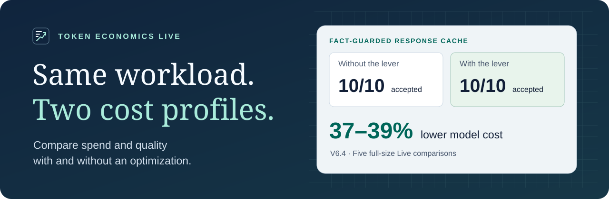
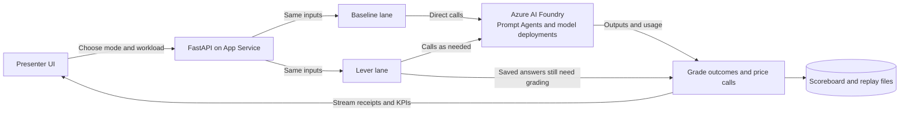

# Token Economics Live

<p align="center">
  <a href="https://app-tokecon-q7yxpkuusfxba.azurewebsites.net/">
    
  </a>
</p>

<p align="center">
  <strong>See what an accepted AI answer or invoice really costs.</strong><br>
  Run the same workload with and without a cost lever. Compare what passed and what each run cost.
</p>

<p align="center">
  <a href="https://app-tokecon-q7yxpkuusfxba.azurewebsites.net/"></a>
  <a href="#demo-walkthrough"></a>
</p>

<p align="center">
  
  
  
  <a href="https://github.com/sauravraghuvanshi/token-economics-live/actions/workflows/ci-deploy.yml"></a>
</p>

## What is Token Economics Live?

Token Economics Live is a hands-on Azure AI Foundry demo for a fictional
CloudDesk support and finance team. It runs English-language support tickets
and synthetic invoices through two lanes: **Without the lever** and **With the
lever**. Both lanes face the same checks. A result counts only if it passes.

The decision metric is **cost per accepted outcome**: total model cost divided
by the number of answers or invoices that pass. A cheaper run isn't a win if it
buys too few usable results.

## Try the live application

**[Open Token Economics Live](https://app-tokecon-q7yxpkuusfxba.azurewebsites.net/)**

When the [Microsoft sign-in gate](docs/operator-guide.md#microsoft-sign-in-for-the-hosted-demo)
is enabled, choose a work or school account in the demo's Entra directory.
Pick a lever and select **Replay last run** to watch a recorded comparison
without an access code or model calls. For a fresh Live run, choose a workload
size, select **Run**, and enter the code provided by the demo operator.

## Demo walkthrough

1. Pick a lever and read **Without the lever**, **With the lever**, and **What to look for**. Start with **Prompt caching**, which changes only the prompt layout.
2. Replay or run the comparison. Open **Inspect** on a request to see why it passed or failed, what the model returned, and which usage was billed.
3. Use **How to implement** for the selected mode's implementation steps. Then open **Scoreboard** to compare spend and acceptance across modes.

The [included recordings](replays/) cover all nine modes at full size.
[Play them offline](#replay-a-live-recording-offline), or use the hosted app to
replay the latest saved run for the selected mode.

## Example use cases

| Experiment | Without the lever | With the lever | What to watch |
|---|---|---|---|
| Prompt caching | The question comes before the shared policies, so the leading text changes. | Put the shared policies first so the model can reuse the stable prefix. Every answer is still generated. | Watch cache reads and writes while asking about invoice reissues, audit logs, and seats. |
| Model routing | Send every question to the frontier model. | Guided Foundry routing sends routine questions to GPT-4.1-mini and harder ones to GPT-6.1 Sol. | Compare a billing-date question with a multi-part service-credit calculation. Inspect the model that actually answered and the cost of choosing it. |
| Response caching | Generate each answer from scratch. | Replay a saved answer only when the topic and relevant facts match. Grade it again against the new question. | A reworded card refund can reuse an answer; an account-credit refund cannot. **Naive similarity** shows what goes wrong when wording alone decides. |
| Retry & kill switch | Retry failed invoices up to six total attempts, including on repeated FX errors. | Allow one initial attempt and at most three retries. Hand off unresolved invoices; a tighter budget can stop earlier. | Contrast a recoverable OCR error with a simulated currency outage. **Stop baseline retries** prevents new baseline retries without stopping the other lane. |

## Highlights

- **Per-request receipts.** Inspect shows pass/fail evidence, the Foundry agent
  and version, raw token usage, and itemized costs.
- **Two different kinds of caching.** Prompt caching reuses input processing;
  response caching skips answer generation on a hit. The response-cache
  comparison withholds its savings verdict if either lane reports provider
  cache reads or writes.
- **Fresh-input routing economics.** Guided routing includes the classifier,
  router fee, and any automatic cache writes. It withholds the verdict if
  either lane reads cached input or the direct baseline writes it.
- **Presenter control.** The baseline stop lets an in-flight attempt finish
  and counts its cost. Later baseline invoices get one initial attempt. A
  stopped run doesn't replace the previous recording or Scoreboard result.

## Hosted verification — 26 November 2026 (V6.4)

**90 of 90 completed Live comparisons passed** on `48f0034`, published by
[GitHub Actions](https://github.com/sauravraghuvanshi/token-economics-live/actions/runs/45854094935).
That's five rounds of all nine modes at both default sizes (five questions or
three invoices) and full sizes (10 questions or six invoices). These comparisons
ran through the deployed streaming API; the automated browser suite used Fake
mode. Percentages below are cost per accepted outcome at configured list rates.

| Mode | Accepted, without → with | Measured result across five full-size rounds |
|---|---:|---|
| Prompt caching | 10/10 → 10/10 | 69.08–78.30% lower cost; cached input reads confirmed |
| Guided Foundry router | 10/10 → 10/10 | 28.23–30.47% lower fresh-input cost, including routing overhead and cache-write charges |
| Decision router | 10/10 → 10/10 | 11.97–27.88% lower cost at full size |
| Small-only | 10/10 → 10/10 | 72.35–74.45% lower cost; no quality loss observed in these rounds |
| Fact-guarded cache | 10/10 → 10/10 | 37.23–39.08% lower cost, four saved answers, and zero provider cache reads or writes in either lane |
| Naive similarity | 10/10 → 8/10 | Both changed-fact hits failed as expected |
| Three-retry guardrail | 4/6 → 4/6 | Six baseline attempts versus four with the lever on each simulated FX failure |
| No retries | 4/6 → 2/6 | Recoverable invoices were handed off as expected |
| Tight kill switch | 4/6 → 2/6 | The spend limit stopped retries after failed first attempts |

Guided Foundry used GPT-4.1-mini for six answers and GPT-6.1 Sol for four in
every full-size round; the default split was three and two. Full-size support
batches took 32.58–63.77 seconds. In the separate Decision router mode, one
default-size run cost 3.62% more despite preserving all five answers.

The existing $2 rolling-hour guard interrupted four attempts; they were kept
separately and verification resumed without raising the cap. A separate Live
manual-stop run blocked a third baseline attempt and let the lever lane finish.
The [round-five full-size recordings](replays/) reproduced every row and KPI
offline. The results describe this workload and cache state, not a savings
guarantee for other traffic.

## How it works



In Live mode the backend calls Foundry with its managed identity. It checks
support answers for required facts, policy citations, and decisions. Invoices
must pass field and arithmetic validation and the Decision review. The browser
receives the resulting receipts, not an Azure credential.

### Foundry agents

In [Foundry](https://ai.azure.com/), open **Token Economics Live**
(`token-economics-live`) and filter **Agents** by `tokecon-`. The app uses
separate, version-pinned Prompt Agents and checks the agent reference on each
answer call. A response-cache hit skips the answer agent entirely.

| Workload | Without the lever | With the lever |
|---|---|---|
| Support | `tokecon-support-baseline` | `tokecon-support-lever`, `tokecon-support-lever-small`, `tokecon-support-lever-router` |
| Invoices | `tokecon-invoice-baseline` | `tokecon-invoice-lever` |

## Technology

| Layer | Technology |
|---|---|
| Frontend | HTML, CSS, JavaScript, and self-hosted fonts; no frontend build step |
| Backend | Python 3.12, FastAPI, Gunicorn/Uvicorn, and server-sent events |
| AI | Azure AI Foundry Prompt Agents, Model Router, Decision, and embeddings |
| Hosting and security | Linux Azure App Service, managed identity, private Key Vault, and Application Insights |
| Delivery | Bicep and Azure Developer CLI for infrastructure; GitHub Actions and Azure OIDC for releases |

## Continuous delivery

### GitHub Actions releases

[The workflow](.github/workflows/ci-deploy.yml) checks Python and JavaScript,
runs unit tests, and tests the packaged app through five Fake rounds at each
workload size. Chromium checks the presenter at two desktop sizes and on
mobile. These checks do not call Foundry.

When enabled, a successful push or manual run against current `main` publishes
the tested ZIP to the existing App Service. The job verifies the deployed
commit, health, five model deployments, six agents, and pricing readiness.
GitHub uses a branch-scoped OIDC credential and an app-scoped managed identity;
the workflow doesn't need a publish profile, client secret, or demo access
code. Public liveness, readiness, and build checks let releases verify a
sign-in-protected app without accessing its demo APIs. See the
[one-time OIDC setup](docs/operator-guide.md#github-actions-releases).

## Run locally

Use **Python 3.12**. Fake mode runs all nine scenarios without Azure credentials.

```powershell
git clone https://github.com/sauravraghuvanshi/token-economics-live.git
Set-Location token-economics-live
py -3.12 -m venv .venv
.\.venv\Scripts\python.exe -m pip install -r requirements.txt
$env:FOUNDRY_MODE = 'fake'
$env:TIGHT_KILL_SWITCH_USD = '0.0007'
.\.venv\Scripts\python.exe -m uvicorn app.main:app --host 127.0.0.1 --port 8000
```

Open [localhost:8000](http://127.0.0.1:8000). The budget above is for Fake
fixtures only. Copy [`.env.example`](.env.example) to `.env` if you want to keep
non-secret local overrides.

### Replay a Live recording offline

After installing the requirements, start the app with these settings in place
of the Fake-mode settings. This uses the checked-in full-size recordings rather
than local runs and needs no Azure access.

```powershell
$env:REPLAY_ONLY = 'true'
$env:REPLAY_DIR = 'replays'
.\.venv\Scripts\python.exe -m uvicorn app.main:app --host 127.0.0.1 --port 8000
```

## Azure configuration and deployment

For a new environment, use the [Azure deployment guide](docs/operator-guide.md#azure-configuration-and-deployment)
to confirm regional quota, configure the five model deployments, provision
App Service and Key Vault with Bicep, and publish the six Foundry agents. The
guide also covers [hosted access and readiness](docs/operator-guide.md#hosted-access-and-readiness),
[live acceptance checks](docs/operator-guide.md#verify-real-usage-and-dry-run-the-demo),
and [presenter recovery](docs/operator-guide.md#present-and-recover).

## Test the demo

From a second terminal with the local Fake app running:

```powershell
.\.venv\Scripts\python.exe -m pip install -r requirements-dev.txt
.\.venv\Scripts\python.exe -m ruff check .
.\.venv\Scripts\python.exe -m mypy app
.\.venv\Scripts\python.exe -m pytest -q
.\.venv\Scripts\python.exe -m scripts.smoke_test --base-url http://127.0.0.1:8000 --source fake --rounds 5 --assert-stories --verify-replays
.\.venv\Scripts\python.exe -m scripts.smoke_test --base-url http://127.0.0.1:8000 --source fake --rounds 5 --max-counts --assert-stories --verify-replays
```

For a browser check, run `.\.venv\Scripts\python.exe -m scripts.browser_test --channel msedge`.
For Chromium, install it with `.\.venv\Scripts\python.exe -m playwright install chromium`
and omit `--channel`.

## Project structure

| Path | What's there |
|---|---|
| [`app/`](app/) | FastAPI routes, Foundry calls, grading, and the four levers |
| [`app/static/`](app/static/) | Presenter UI and per-mode implementation walkthroughs |
| [`app/data/`](app/data/) | Synthetic CloudDesk policies, support questions, and invoices |
| [`config/pricing.json`](config/pricing.json) | Model meters and verified list rates |
| [`infra/`](infra/) | Azure hosting, roles, model deployments, and GitHub OIDC identity |
| [`scripts/`](scripts/) and [`tests/`](tests/) | Agent sync, smoke runs, replay exports, and regression tests |
| [`replays/`](replays/) | Nine verified full-size Live recordings |

## Before using this outside a demo

- Use synthetic data only. Inspect and recordings preserve request and response details.
- Keep one Gunicorn worker on one App Service instance. The active-run guard and
  response cache are process-local; `/home/data` persists the spend ledger,
  Scoreboard, and recordings. Move coordination and state to shared services
  before scaling out.
- The $2 rolling-hour guard is for inference, not hosting. The App Service plan
  and private endpoint were estimated at about $64 per 730 hours at configured
  list rates, before usage, DNS, Key Vault, and monitoring.
- Guided routing uses [preview per-request routing controls](https://learn.microsoft.com/en-us/azure/foundry/openai/how-to/model-router-routing-controls)
  without a production SLA. It requires Foundry to confirm the routing mode
  and an eligible model; it does not silently fall back. `PROMPT_CACHE_MODE=auto`
  is for older deployments and does not guarantee isolation from provider caching.

## Further reading

- [Implementation specification and pricing rules](Instruction.md)
- [Operator guide and historical verification](docs/operator-guide.md)
- [Azure AI Foundry portal](https://ai.azure.com/)
